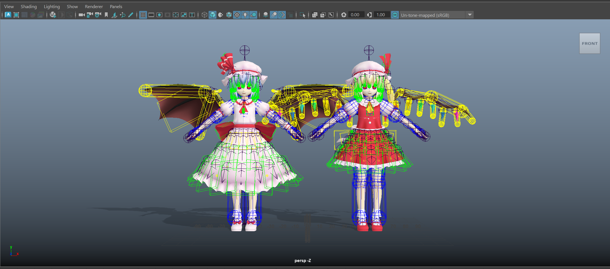
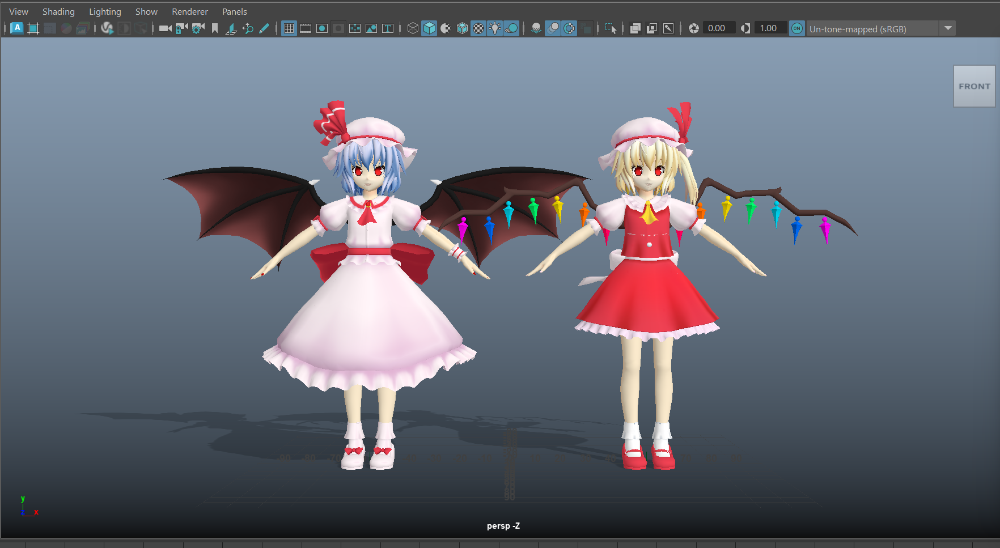
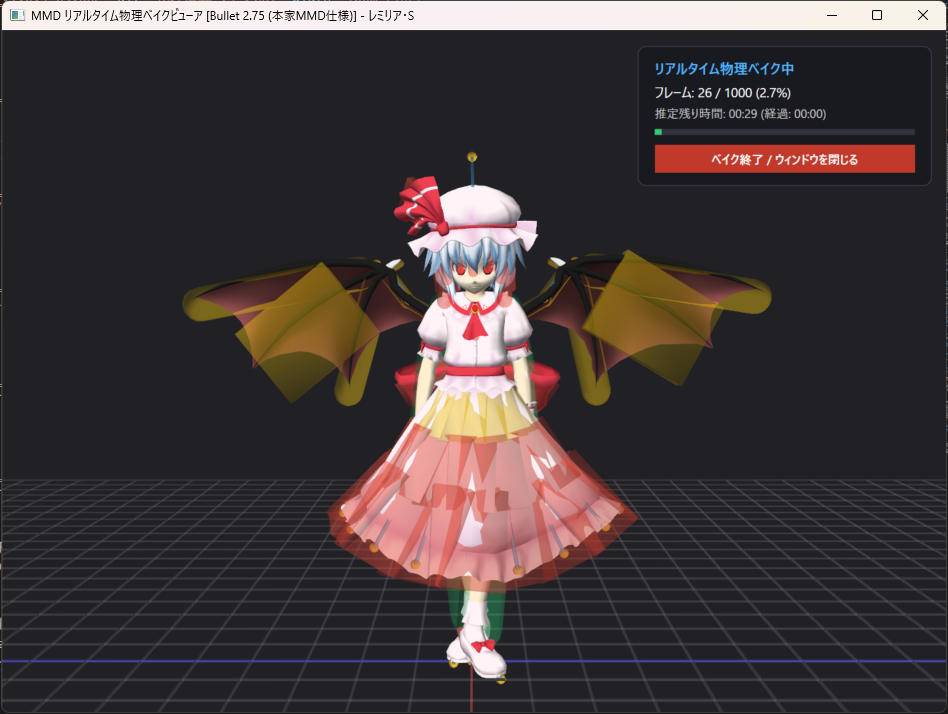
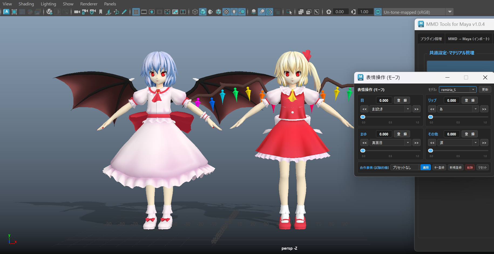
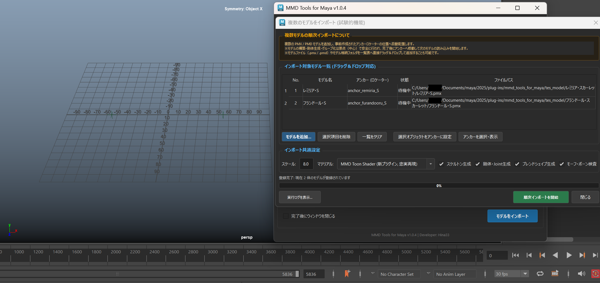
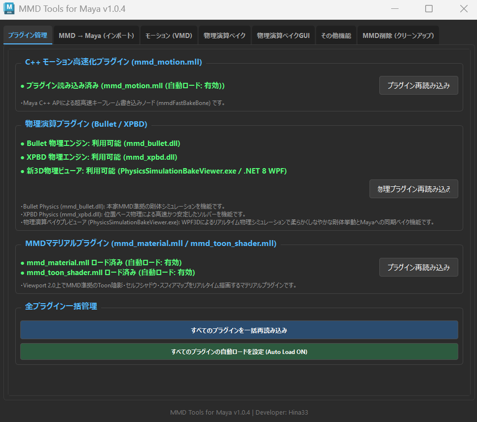

# MMD Tools for Maya (v1.0.4)

<p align="center">
  <br>
  <sub>ビューポート画面 - モデルインポート[ボーン・剛体・Joint表示] (v1.0.4)</sub>
</p>

<p align="center">
  <br>
  <sub>ビューポート画面 - モデルインポート[ボーン・剛体・Joint非表示] (v1.0.4)</sub>
</p>

<p align="center">
  <br>
  <sub>物理演算ベイクGUI - テクスチャ対応 (v1.0.4)</sub>
</p>

<p align="center">
  <br>
  <sub>表情操作（モーフ） - レミリアとフランの帽子off (v1.0.4)</sub>
</p>

<p align="center">
  <br>
  <sub>複数モデルのインポート画面 - ドラッグ&ドロップ対応 (v1.0.4)</sub>
</p>

Autodesk Maya 上で MMD（PMX形式推奨、非推奨：PMD / DirectX .x）モデルやアクセサリのインポート・エクスポート、VMDモーション・カメラ・音声のインポート、HumanIKリグ定義、モデル構造の一括解析・辞書登録、表情操作（モーフ）、およびリアルタイムレンダリングベイク対応の物理演算を行うための Mayaのプラグインです。

---

## 主な特徴

| カテゴリ                 | 機能                        | 概要                                                                                                |
| :----------------------- | :-------------------------- | :-------------------------------------------------------------------------------------------------- |
| **モデルインポート**     | PMX / PMD / .x 読み込み     | メッシュ、ボーン、ウェイト、テクスチャ、表情モーフを自動展開（PMX推奨、PMD/.xは非推奨・物理非対応） |
| **質感・シェーディング** | MMD専用シェーダー           | トゥーン影、スフィアマップ、輪郭線を再現し、Maya上での白飛びや暗さを解消                            |
| **アニメーション**       | VMDモーション・音源取り込み | キャラクターダンス、カメラ、照明、音源（WAV）をキーフレーム展開し即座に再生可能                     |
| **物理演算ベイク**       | 3つの物理エンジン対応       | 外部描画連携のリアルタイムベイク、本家準拠のBullet、高速・安定のXPBDから選択可能                    |
| **文字コード・堅牢性**   | 辞書登録・自動リネーム      | 特殊文字・中国語モデルの文字化けを防止し、未登録漢字の対話型辞書登録をサポート                      |
| **解析ツール**           | モデル情報解析              | PMX内部の材質・剛体・ジョイント情報をワンクリックで確認・テキスト出力                               |

> [!WARNING]
> **【DirectX .x 形式の非推奨について】**: DirectX (.x) 形式のインポート機能は現在**非推奨**となっています。
> 新しいアップデートにて、PMD形式でインポートした場合、PMXに変換する機能を実装しました。
> まだPMX変換機能は試験的でモデルによっては正常に変換できない場合があるかもしれません。
> その場合、事前に「PMXエディタ」等でPMX形式に保存・変換してから読み込んで下さい。

### 物理演算ベイク方式の比較

| 方式                                                         | 実行環境 / 連携                                           | 特徴とメリット                                                                                                                                       | 推奨用途                                                                                                                             |
| :----------------------------------------------------------- | :-------------------------------------------------------- | :--------------------------------------------------------------------------------------------------------------------------------------------------- | :----------------------------------------------------------------------------------------------------------------------------------- |
| **物理演算ベイクソフトウェア**<br>(リアルタイムレンダリング) | 外部ソフトウェア<br>(C# / BulletSharp)                    | 独立ウィンドウで物理挙動を描画しながら高速シミュレーションを行い、結果をMayaへ直接送信・ベイク。Mayaの描画負荷の影響を受けない                       | 長髪や多重スカートなどの重い揺れもの、挙動を目視確認しながらきれいで自然な物理演算でベイクしたい場合。こちらの使用をおすすめします。 |
| **Bullet物理 (GUI無し)**                                     | Maya内蔵<br>(C++ mmd_bullet_275.dll / mmd_bullet_283.dll) | MMD本家採用の「Bullet 2.75（挙動再現重視）」および改良版「Bullet 2.83.7（安定性重視）」の両方を搭載。GUIから自由に切り替えて高速にシミュレーション。 | MMD本家と同一の物理挙動をMaya単体で高速にテスト・ベイクしたい場合                                                                    |
| **XPBD物理 (GUI無し)**                                       | Maya内蔵<br>(C++ mmd_xpbd.dll)                            | 拡張位置ベース動力学（XPBD）によるシミュレーション。（※現在挙動が不安定なため非推奨）                                                                | 使用をおすすめしません。                                                                                                             |

---

## 動作要件と開発環境

- **Maya 2025**: 動作確認済み、推奨
- **Python**:3.11.4
- **OS**: Windows 11 (x64)
- **MikuMikuDance**: 9.32(x64)

---

## インストール手順

Maya の標準プラグインディレクトリ（`plug-ins`）に配置してロードします。plug-insフォルダが無い場合は作成してください。

### 1. ファイルの配置構造

Maya のプラグインフォルダに、以下の構造のままフォルダごと配置してください：

```text
C:\Users\<ユーザー名>\Documents\maya\<バージョン>\plug-ins\
├── mmd_tools_for_maya_plugin.py      # 【必須】Maya用プラグインローダー (Mayaが最初に読み込むファイル)
└── mmd_tools_for_maya/               # 【必須】ツール本体のフォルダ
    ├── __init__.py                   # 初期化スクリプト
    ├── ui/                           # 操作画面 (モダン統合GUI・表情操作パネル)
    ├── converters/                   # 読み込み・書き出し変換スクリプト (PMX/PMD/VMD/PMD2PMX)
    ├── pmx_analyzer/                 # モデル構造の解析・一括保存・ユーザー辞書登録
    ├── mmd_core/                     # MMDデータ解析コア (PMX/PMD/VMD/VPD/X)
    ├── bullet_engine/                # 本家MMD再現 Bullet物理演算モジュール (zlib)
    │   └── bin/                      # 【Bullet 2.75 / 2.83.7 物理エンジンDLL】
    ├── cpp_engine/                   # 自作 XPBD 物理演算モジュール (MIT)
    │   └── bin/mmd_xpbd.dll          # 【XPBD物理エンジンDLL】
    ├── mmd_material_plugin/          # MMD専用シェーダープラグイン (Viewport 2.0 対応)
    │   └── bin/                      # 【シェーダープラグイン本体 (mmd_material.mll)】
    ├── mmd_toon_plugin/              # MMD専用トゥーンシェーダープラグイン (Viewport 2.0 対応)
    │   └── bin/                      # 【トゥーンシェーダープラグイン本体 (mmd_toon_shader.mll)】
    ├── mmd_motion_plugin/            # 高速モーション処理プラグイン
    │   └── bin/                      # 【モーションプラグイン本体 (mmd_motion.mll)】
    ├── physics_bake_cs/              # MMD物理演算リアルタイムベイクアプリ
    │   └── bin/Release/              # 【ベイク実行本体 (PhysicsSimulationBakeViewer.exe)】
    ├── physics_bridge_cs/            # MMD物理演算シミュレーションビューア
    │   └── bin/Release/              # 【ビューア実行本体 (MmdPhysicsBridge.exe)】
    ├── asset/                        # ユーザー辞書・マッピングデータ格納フォルダ
    ├── toon/                         # 標準トゥーン影テクスチャ
    └── docs/                         # 詳細技術仕様書
```

### 2. Maya でのロード手順（ツール本体の起動）

1. Maya を起動します。
2. 上部メニューから **ウィンドウ (Windows) > 設定/プリファレンス (Settings/Preferences) > プラグイン マネージャ (Plug-in Manager)** を開きます。
3. プラグイン一覧の中から **`mmd_tools_for_maya_plugin.py`** を探します。
4. **ロード (Loaded)** および **自動ロード (Auto load)** のチェックボックスをオンにします。
5. Maya メインメニューバーの右端に **[MMD]** メニューが追加され、**MMD to Maya (GUI)** をクリックするとツールウィンドウが起動します。

### 3. プラグイン関連の確認方法

本ツールには複数の`.dll`や`.mll`を使用しています。主にMMDシェーダーや高速化などに使用しています。

<p align="center">
  <br>
  <sub>プラグイン管理タブ[画像のようになっていればOK] (v1.0.4)</sub>
</p>

- **自動ロード（通常はこちら）**:
  - プラグインを有効にすると自動的にmll(C++でコンパイルしたプラグイン)は有効になります。特別な操作は必要ありません。
  - 正しく読み込まれているかは、画像を参考に「プラグイン管理」のステータス欄に **[● プラグイン読み込み済み]** と緑色で表示されていることで確認できます。
  - もし **[○ プラグイン未読み込み]** となっている場合は、下にある **[すべてのプラグインを一括再読み込み]** ボタンを1クリックするだけで読み込まれます。

- モデルが緑色になってしまっている場合、プラグインは読み込まれていないので、**[すべてのプラグインを一括再読み込み]** と **[すべてのプラグインの自動ロードを設定]** を押して、再度シーンやモデルを読み込んでください。

- **手動で適用・解除・確認する場合**:
  1. Maya 上部メニュー **ウィンドウ > 設定/プリファレンス > プラグイン マネージャ** を開きます。
  2. リスト上部の検索欄に **「mmd」と調べて`mmd_*.mll`** を確認できます。

---

## 技術仕様書 (Technical Specifications)

本ツールの内部アーキテクチャや、モデルのインポートから物理演算ベイクに至る一連の仕組み・図解・各詳細ドキュメントへのご案内については、以下の技術仕様書をご覧ください：

- [**MMD Tools for Maya 技術仕様書 (インポートから物理演算ベイクまでの仕組み解説)**](docs/technical_overview_guide.md)

---

## 今回のアップデート内容 (v1.0.4)

- **モーフ生成（BlendShape）の高速化と表情操作の修正**:
  - OpenMaya 2.0 API による直接ターゲット書き込み（Sparse Target Delta Direct Write）を導入し、メッシュ複製ループを廃止してモーフ生成処理を大幅高速化（数百モーフを数秒台で生成）。
- **透過材質モーフ（ドロワoff・帽子off等）の修正**:
  - `mmdToonShader`（ShaderFX / OGSFX）および標準マテリアルにおいて、`transparency`（RGB反転透過）と `diffuseAlpha`（直接アルファ）の双方へ出力を並列供給する二重透過制御を実装。
  - 「ドロワoff」などの消去・出現パーツ連動モーフにおいて、透過度切り替えと同時に拡散受光（`diffuse`）を動的制御し、非表示パーツの黒浮きや影の浮き出を防止。
- **Bullet 2.75 を追加**: 前回のバージョンではBullet 2.83.7を使用していましたが、Bullet 2.75 も追加しMMDの挙動をより再現するよう選択できるようにしました。
- **複数モデルの対応と順次物理ベイク機能の実装 (内部Bullet & 外部ビューア双方対応)**:
  - 複数のモデルをアンカーポイントにインポートできるようにしました。(ドラッグ＆ドロップにも対応)
  - 物理ベイクではモデル同士が重なった際の剛体・ジョイント追突（反発や吹き飛び）を避けるため、各モデルを1体ずつ独立して計算・ベイクするアイソレーション順次ベイク機構を実装。個別モデル指定にも対応しています。
- **外部物理ベイクビューアのテクスチャ対応とカメラ最適化**
- **インポート開始直後の実行ログ即時表示統合**:
  - インポートボタン押下直後に実行ログダイアログを表示し、モーフ・ボーン名の辞書照合から各構築ステップの進行状況をリアルタイムに可視化。
- **新規シェーダープラグイン(mmd_toon_shader.mll)開発**:
  - Viewport 2.0 に対応した MMD 専用 C++ トゥーンシェーダーノードプラグインを開発。トゥーンマップやスフィアマップ（.spa/.sph）、材質モーフ透過にネイティブ対応し、ビューポート上で軽快なセル調陰影描画を実現。
- **PMDからPMXへの変換ツール制作およびインポート時自動変換**
- **地面影の追加**
- **その他調整及びGUI操作性のブラッシュアップ**

---

## 今後の開発ロードマップ (Roadmap - v1.0.5 予定)

次期バージョン（**v1.0.5**）では、以下の内容や修正を予定しています：

- **Toonシェーディングの調整**
- **ステージモデルやカメラモーションの最適化**
- **その他調整及びGUI操作性のブラッシュアップ**

以下検討中の内容：

- **pmx, vmd, wavのドラッグ＆ドロップ一括適用**
- **胴体の物理演算の最適化検討**
- **レンダリングの対応検討**
- **準初期辞書、個人辞書の最適化検討**

---

## ライセンスについて (License & Modular Isolation)

本プロジェクトは、オープンソースの透明性と利用者の自由度を最大限に高めるため、**フォルダ単位でのライセンス分離設計（カプセル化）** を採用しています。

- **プラグイン本体**: **MIT License**
  - 入出力コア（`mmd_core/`）、自作XPBD物理エンジン（`cpp_engine/`）、解析ツール（`pmx_analyzer/`）、GUI（`ui/`）、シェーダープラグイン（`mmd_material_plugin/`, `mmd_toon_plugin/`）、モーションプラグイン（`mmd_motion_plugin/`）、各種変換ユーティリティ（`converters/`）等はすべて MIT ライセンスです。
- **Bullet エンジンモジュール (`bullet_engine/`)**: **zlib License**
  - Bullet Physics Library（Erwin Coumans / Bullet 公式）のソースコードを含みます。
- **外部物理ビューア BulletSharp 依存 (`physics_bake_cs/`, `physics_bridge_cs/`)**: **zlib License**
  - .NET 用 Bullet ラッパーライブラリ BulletSharp（Andres Traks）を含みます。

---

## スペシャルサンクス(謝辞)

以下の方々の資料やソースコード等を拝見し、仕様・挙動を参考にさせていただきました。

- [mmdpaimaya](https://github.com/phyblas/mmdpaimaya)
- [Bullet Physics Library](https://github.com/bulletphysics/bullet3)
- [MikuDanceStudio](https://github.com/jstzwj/MikuDanceStudio)
- [MMD Tips](https://czpanel.com/lecture/mmd/)
- [VMDメモ](https://hariganep.seesaa.net/article/201103article_1.html)
- [PMXエディタ(PMX仕様.txt)](https://kkhk22.seesaa.net/category/14045451-2.html)
- [ＭＭＤモデルの物理演算設定　～剛体編～](https://site.nicovideo.jp/ch/userblomaga_thanks/archive/ar679314)

---

## AIネイティブ開発 (AI-Powered Development)

本プロジェクトは、**最先端AIアシスタント（Antigravity / Gemini / Claude）とのペアプログラミング**により開発されています。

---

## クレジット・ライセンス表記

- **Author**: Hina33
- **Bullet Physics Library**: Copyright (c) 2003-2015 Erwin Coumans (zlib License)
- **BulletSharp**: Copyright (c) 2007-2018 Andres Traks (zlib License)
- **スクリーンショット使用モデル**:
  - 『レミリア・スカーレット』 モデリング・セットアップ：すけ 様（[ニコニ立体: td27083](https://3d.nicovideo.jp/works/td27083)）
  - 『フランドール・スカーレット』 モデリング・セットアップ：すけ 様（[ニコニ立体: td27081](https://3d.nicovideo.jp/works/td27081)）
