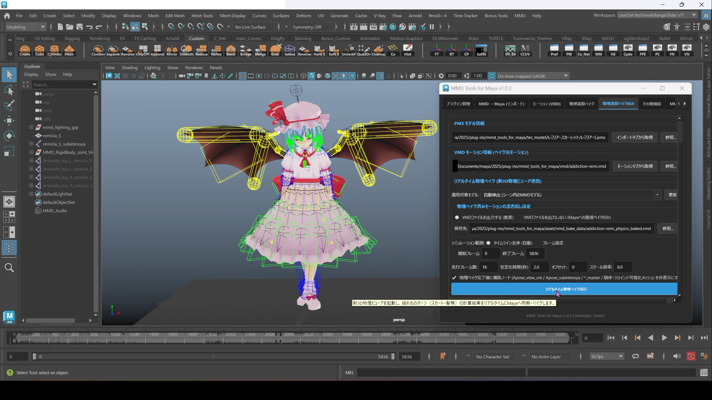
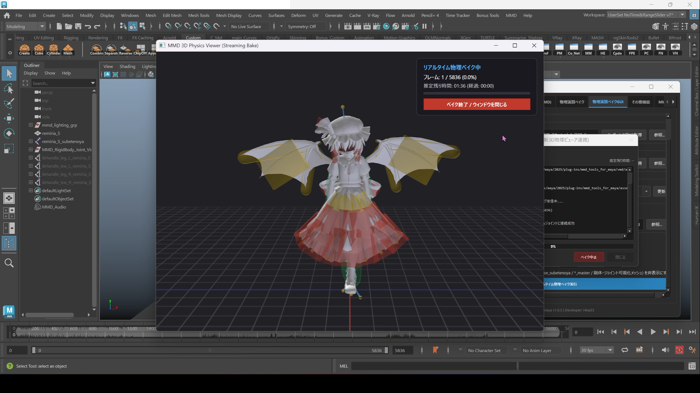
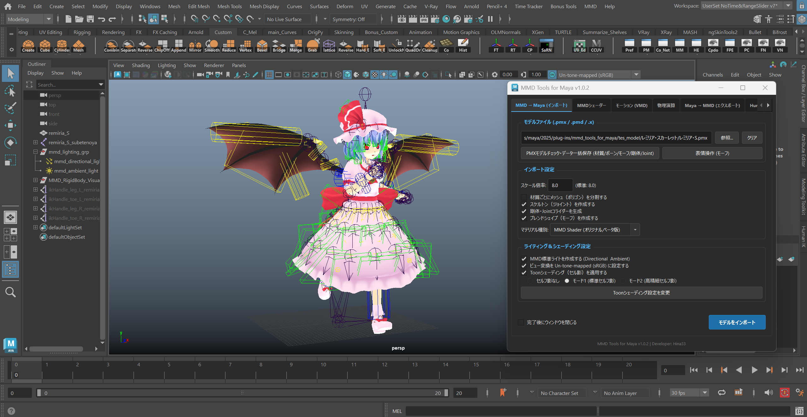
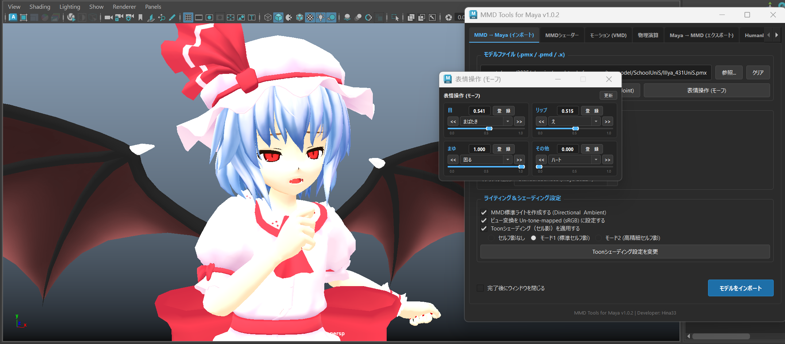

# MMD Tools for Maya (v1.0.3)

<p align="center">
  <br>
  <sub>物理演算ベイクGUI：モデル・剛体・Joint可視化とベイク設定画面 (v1.0.3)</sub>
</p>

<p align="center">
  <br>
  <sub>リアルタイムレンダリングベイク：外部物理シミュレーションによるリアルタイム画面同期＆ベイク (v1.0.3)</sub>
</p>

<p align="center">
  <br>
  <sub>モデルインポート＆MMD専用シェーダー [べータ版]：Maya上でのアニメ調トゥーン影・スフィアマップ質感再現 (画像はv1.0.2)</sub>
</p>

<p align="center">
  <br>
  <sub>表情操作（モーフ） [べータ版]：スライダーによる直感的なブレンドシェイプ調整・登録 (画像はv1.0.2)</sub>
</p>

Autodesk Maya 上で MMD（PMX形式推奨、非推奨：PMD / DirectX .x）モデルやアクセサリのインポート・エクスポート、VMDモーション・カメラ・音声のインポート、HumanIKリグ定義、モデル構造の一括解析・辞書登録、表情操作（モーフ）、およびリアルタイムレンダリングベイク対応の物理演算を行うための Mayaのプラグインです。

> [!NOTE]
> 本バージョン（**v1.0.3**）は、**リアルタイムレンダリングベイク搭載（外部物理シミュレーションソフトウェアによるリアルタイムベイク）** を導入しました。複雑な髪や衣装を持つモデルでも、Mayaの描画負荷に左右されず、リアルタイムに挙動を確認しながら自然な物理演算でベイクできるようになりました。
> 内包しているuser_dictionary.jsonは私が入力したテストモデル用の個人辞書です。正確ではありません。ご自身で調節をお願いします。

---

## 主な特徴

| カテゴリ                 | 機能                        | 概要                                                                                                |
| :----------------------- | :-------------------------- | :-------------------------------------------------------------------------------------------------- |
| **モデルインポート**     | PMX / PMD / .x 読み込み     | メッシュ、ボーン、ウェイト、テクスチャ、表情モーフを自動展開（PMX推奨、PMD/.xは非推奨・物理非対応） |
| **質感・シェーディング** | MMD専用シェーダー           | トゥーン影、スフィアマップ、輪郭線を再現し、Maya上での白飛びや暗さを解消                            |
| **アニメーション**       | VMDモーション・音源取り込み | キャラクターダンス、カメラ、照明、音源（WAV）をキーフレーム展開し即座に再生可能                     |
| **物理演算ベイク**       | 3つの物理エンジン対応       | 外部描画連携のリアルタイムベイク、本家準拠のBullet、高速・安定のXPBDから選択可能                    |
| **文字コード・堅牢性**   | 辞書登録・自動リネーム      | 特殊文字・中国語モデルの文字化けを防止し、未登録漢字の対話型辞書登録をサポート                      |
| **解析ツール**           | モデル情報解析              | PMX内部の材質・剛体・ジョイント情報をワンクリックで確認・テキスト出力                               |

> [!WARNING]
> **【PMD / DirectX .x 形式の非推奨と今後の対応について】**: PMD形式およびDirectX (.x) 形式のインポート機能は現在**非推奨**となっています。物理演算（剛体・ジョイント）には対応しておらず、**今後のアップデートで使用できなくなる可能性があります**。ご利用のモデルやアクセサリ小物は、事前に「PMXエディタ」等でPMX形式に保存・変換してから読み込むことを強く推奨します。
> **材質ごとにメッシュ（ポリゴン）を分割する** はメッシュのみのインポートです。

### 物理演算ベイク方式の比較

| 方式                                                         | 実行環境 / 連携                        | 特徴とメリット                                                                                                                 | 推奨用途                                                                                                                             |
| :----------------------------------------------------------- | :------------------------------------- | :----------------------------------------------------------------------------------------------------------------------------- | :----------------------------------------------------------------------------------------------------------------------------------- |
| **物理演算ベイクソフトウェア**<br>(リアルタイムレンダリング) | 外部ソフトウェア<br>(C# / BulletSharp) | 独立ウィンドウで物理挙動を描画しながら高速シミュレーションを行い、結果をMayaへ直接送信・ベイク。Mayaの描画負荷の影響を受けない | 長髪や多重スカートなどの重い揺れもの、挙動を目視確認しながらきれいで自然な物理演算でベイクしたい場合。こちらの使用をおすすめします。 |
| **Bullet物理 (GUI無し)**                                     | Maya内蔵<br>(C++ mmd_bullet.dll)       | MMD本家と同じBullet Physicsエンジンを用いて高速にシミュレーション。スカートなどの物理演算が震えますが高速です。                | MMD本家と同一の物理挙動をMaya単体で簡易的に高速でテストベイクしたい場合                                                              |
| **XPBD物理 (GUI無し)**                                       | Maya内蔵<br>(C++ mmd_xpbd.dll)         | 拡張位置ベース動力学（XPBD）によるシミュレーション。物理演算がうまく機能しない。                                               | 使用をおすすめしません。                                                                                                             |

---

## 動作要件と開発環境

- **Maya 2025**: 動作確認済み,推奨
- **Python**:3.11.4
- **OS**: Windows 11 (x64)
- **MikuMikuDance**: 9.32(x64)

---

## インストール手順

Maya の標準プラグインディレクトリ（`plug-ins`）に配置してロードします。

### 1. ファイルの配置構造

Maya のプラグインフォルダに、以下の構造のままフォルダごと配置してください：

```text
C:\Users\<ユーザー名>\Documents\maya\<バージョン>\plug-ins\
├── mmd_tools_for_maya_plugin.py      # 【必須】Maya用プラグインローダー (Mayaが最初に読み込むファイル)
└── mmd_tools_for_maya/               # 【必須】ツール本体のフォルダ
    ├── __init__.py                   # 初期化スクリプト
    ├── ui/                           # 操作画面 (GUI・表情操作パネル)
    ├── converters/                   # 読み込み・書き出し変換スクリプト
    ├── pmx_analyzer/                 # モデル構造の解析・ボーン辞書登録
    ├── mmd_core/                     # MMDデータ解析コア (PMX/PMD/VMD/X)
    ├── bullet_engine/                # 本家MMD再現 Bullet物理演算モジュール
    │   └── bin/mmd_bullet.dll        # 【Bullet物理エンジンDLL】
    ├── cpp_engine/                   # 自作 XPBD 物理演算モジュール
    │   └── bin/mmd_xpbd.dll          # 【XPBD物理エンジンDLL】
    ├── mmd_material_plugin/          # MMD専用シェーダープラグイン (Viewport 2.0 対応)
    │   └── bin/                      # 【シェーダープラグイン本体 (mmd_material.mll)】
    ├── mmd_motion_plugin/            # 高速モーション処理プラグイン
    │   └── bin/                      # 【モーションプラグイン本体 (mmd_motion.mll)】
    ├── physics_bake_cs/              # MMD物理演算リアルタイムベイクアプリ
    │   └── bin/Release/              # 【ベイク実行本体 (MmdPhysicsViewer.exe)】
    ├── physics_bridge_cs/            # MMD物理演算シミュレーションビューア
    │   └── bin/Release/              # 【ビューア実行本体 (MmdPhysicsBridge.exe)】
    ├── asset/                        # ユーザー辞書・マッピングデータ格納フォルダ
    ├── toon/                         # 標準トゥーン影テクスチャ
    └── docs/                         # 詳細技術仕様書
```

### 2. Maya でのロード手順（ツール本体の起動）

1. Maya を起動します。
2. 上部メニューから **ウィンドウ (Windows) > 設定/プリファレンス (Settings/Preferences) > プラグイン マネージャ (Plug-in Manager)** を開きます。
3. プラグイン一覧の中から **`mmd_tools_for_maya_plugin.py`** を探します。
4. **ロード (Loaded)** および **自動ロード (Auto load)** のチェックボックスをオンにします。
5. Maya メインメニューバーの右端に **[MMD]** メニューが追加され、**MMD to Maya (GUI)** をクリックするとツールウィンドウが起動します。

### 3. MMDシェーダープラグイン (`mmd_material.mll`) の適用方法

本ツールのMMD質感再現（トゥーン影や輪郭線など）には、高速なC++プラグイン **`mmd_material.mll`** を使用します。

- **自動ロード（通常はこちら）**:
  - モデルをインポートする際や、ツール画面の「MMDシェーダー」タブを開いた際に**自動的に検出されて読み込まれます**。特別な操作は必要ありません。
  - 正しく読み込まれているかは、「MMDシェーダー」タブ上部のステータス欄に `● プラグイン読み込み済み (mmd_material.mll)` と緑色で表示されていることで確認できます。
  - もし「○ プラグイン未読み込み」となっている場合は、すぐ下にある **[プラグインをリロード]** ボタンを1クリックするだけで読み込まれます。

- **手動で適用・確認する場合（Maya プラグインマネージャから追加）**:
  1. Maya 上部メニュー **ウィンドウ > 設定/プリファレンス > プラグイン マネージャ** を開きます。
  2. 下部の **参照 (Browse)** ボタンをクリックします。
  3. 配置したフォルダ内の `mmd_tools_for_maya/mmd_material_plugin/bin/mmd_material.mll` を選択して開きます。
  4. プラグイン一覧に追加された `mmd_material.mll` の **ロード (Loaded)** および **自動ロード (Auto load)** にチェックを入れます。

---

## 技術仕様書 (Technical Specifications)

本ツールの内部アーキテクチャや、モデルのインポートから物理演算ベイクに至る一連の仕組み・図解・各詳細ドキュメントへのご案内については、以下の技術仕様書をご覧ください：

- [**MMD Tools for Maya 技術仕様書 (インポートから物理演算ベイクまでの仕組み解説)**](docs/technical_overview_guide.md)

---

## 今後の開発ロードマップ (Roadmap - v1.0.4 予定)

次期バージョン（**v1.0.4**）では、以下の内容や修正を予定しています：

- **pmx,vmd,wavのドラックアンドドロップ一括適応**
- **表情操作GUI（モーフ操作）や透過材質の対応と調整**
- **足首のボーン回転の調整**
- **胴体の物理演算の微調整**
- **レンダリングの対応検討**
- **準初期辞書と、ユーザーが実行中に追加保存する個人辞書を分離し、読み込み時に自動マージする機能の検討**
- **その他調整及びGUI操作性のブラッシュアップ**

---

## ライセンスについて (License & Modular Isolation)

本プロジェクトは、オープンソースの透明性と利用者の自由度を最大限に高めるため、**フォルダ単位でのライセンス分離設計（カプセル化）** を採用しています。

- **プラグイン本体**: **MIT License**
  - 入出力コア（`mmd_core/`）、自作XPBD物理エンジン（`cpp_engine/`）、解析ツール（`pmx_analyzer/`）、GUI（`ui/`）、各種ユーティリティ等はすべて MIT ライセンスです。
- **Bullet エンジンモジュール (`bullet_engine/`)**: **zlib License**
  - Bullet Physics Library（Erwin Coumans / Bullet 公式）のソースコードを含みます。

---

## スペシャルサンクス

以下の方々の資料やソースコード等を参考にさせていただきました。

- [mmdpaimaya](https://github.com/phyblas/mmdpaimaya)
- [Bullet Physics Library](https://github.com/bulletphysics/bullet3)
- [MMD Tips](https://czpanel.com/lecture/mmd/)
- [VMDメモ](https://hariganep.seesaa.net/article/201103article_1.html)
- [PMXエディタ(PMX仕様.txt)](https://kkhk22.seesaa.net/category/14045451-2.html)
- [ＭＭＤモデルの物理演算設定　～剛体編～](https://site.nicovideo.jp/ch/userblomaga_thanks/archive/ar679314)

---

## AIネイティブ開発 (AI-Powered Development)

本プロジェクトは、**最先端AIアシスタント（Antigravity / Gemini / Claude）とのペアプログラミング**により開発されています。

---

## クレジット,ライセンス表記

- **Author**: Hina33
- **Bullet Physics Library**: Copyright (c) 2003-2015 Erwin Coumans (zlib License)
- **スクリーンショット使用モデル**: 『レミリア・スカーレット』 モデリング・セットアップ：すけ 様（[ニコニ立体: td27083](https://3d.nicovideo.jp/works/td27083)）
