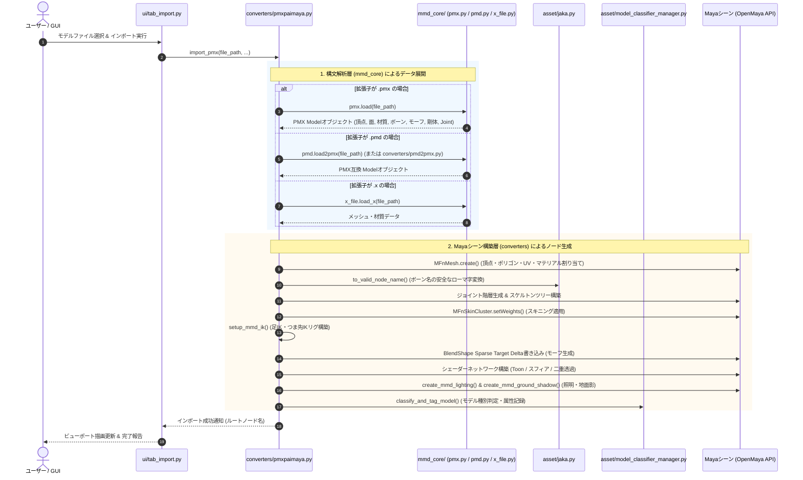

# MMDモデル共通シーン構築技術仕様書 (pmx-pmd-x)

> [!NOTE]
> 本詳細技術仕様書は、AI によって作成・整理されたドキュメントです。内容はソースコードおよび開発記録をもとに記述していますが、実際の動作と細部が異なる場合があります。

本ドキュメントは、PMX、PMD、および DirectX .x の全モデル形式に共通する Maya シーン構築パイプラインのアーキテクチャ仕様書です。
構文解析層（`mmd_core`）とシーン構築層（`converters`）がどのように連携し、どの Python スクリプトがどの順序で呼び出されて各種 Maya ノードを生成・設定していくかの全体フローを図解します。

各ファイル形式固有のバイナリ構造仕様については以下をご参照ください：
- [pmx_model_import_specification.md](pmx_model_import_specification.md) (PMX 2.0 / 2.1 専用仕様)
- [pmd_model_import_specification.md](pmd_model_import_specification.md) (PMD 専用仕様)
- [x_model_import_specification.md](x_model_import_specification.md) (DirectX .x 専用仕様)

---

## 1. `mmd_core` と `converters` の連携・構築フロー図解

MMDモデルのインポート処理は、純粋なデータ構文解析を担う **`mmd_core` パッケージ** と、Maya API 2.0 を駆使してシーンノードを高速構築する **`converters` パッケージ** の明確な役割分担によって成立しています。

### 1-1. 全体読み込み・ノード構築シーケンス図



### 1-2. 各 Python ファイルの責務と呼び出し順序

| 順序 | 実行モジュール | 主な呼び出し関数・クラス | 処理内容と生成される Maya オブジェクト |
| :--- | :--- | :--- | :--- |
| **1** | `ui/tab_import.py` | `on_import_clicked()` | GUI からの入力パラメータ検証、プログレスバー初期化、コンバータ呼び出し |
| **2** | `converters/pmxpaimaya.py` | `import_pmx()` | インポート全体の統括オーケストレーター |
| **3** | `mmd_core/pmx.py` / `pmd.py` / `x_file.py` | `load()` / `load2pmx()` / `load_x()` | バイナリ・テキスト解析、多重エンコード安全デコード、共通オブジェクト化 |
| **4** | `converters/pmxpaimaya.py` | `create_mesh()` | `MFnMesh.create` による超高速ポリゴンメッシュ生成 (`mesh`, `transform`) |
| **5** | `asset/jaka.py` | `to_valid_node_name()` | 日本語ボーン名のローマ字安全変換、名前衝突回避、元の和名属性保持 |
| **6** | `converters/pmxpaimaya.py` | `create_skeleton()` | 親子インデックスに基づくジョイントツリー生成 (`joint`) |
| **7** | `converters/pmxpaimaya.py` | `apply_skinning()` | `skinCluster` 生成、`MFnSkinCluster` によるウェイト一括割り当て |
| **8** | `converters/pmxpaimaya.py` | `setup_mmd_ik()` | 太もも〜足首〜つま先の IK ソルバー構築 (`ikHandle`, `ikRPsolver`, `ikSCsolver`) |
| **9** | `converters/pmxpaimaya.py` | `create_morph_blendshapes()` | BlendShape スパース配列への直接差分注入による表情モーフ一括生成 |
| **10** | `converters/pmxpaimaya.py` | `setup_materials()` | Toon・スフィア・二重透過シェーディングネットワーク自動構築 |
| **11** | `converters/pmxpaimaya.py` | `create_mmd_lighting()` | MMD標準平行光 (`MMD_Directional_Light`) および環境光の生成 |
| **12** | `converters/pmxpaimaya.py` | `create_mmd_ground_shadow()` | Y=0.05 地面影受けプレーンおよびシャドウキャッチャーシェーダー生成 |
| **13** | `asset/model_classifier_manager.py` | `classify_model()` | キャラクター／ステージ／スカイドームの種別判定とメタデータ記録 |

---

## 2. メッシュ高速生成アーキテクチャ (`MFnMesh.create`)

Maya API 2.0（`maya.api.OpenMaya.MFnMesh`）を利用し、Python ループによる個別頂点設定を排除して一括配列渡しにより数十万ポリゴンのモデルを数秒で構築します。

- **頂点座標配列**: `MPointArray`（Z座標の符号を反転して Maya 右手系へ適合）
- **面ポリゴン頂点数配列**: `MIntArray`（三角形面の場合は全要素が 3）
- **面頂点接続インデックス配列**: `MIntArray`
- **テクスチャUV配列**: `MFloatArray`（U値および `1.0 - V` 反転値）
- **シェーディンググループ割り当て**: `MObjectArray` による材質別マテリアル一括割り当て

---

## 3. スケルトン生成と安全名変換 (`asset/jaka.py`)

- **座標系の整合**: MMD のボーン座標系を Maya 座標系へ変換（X, Y, -Z）。
- **親子階層の再帰的構築**: ルートボーンから親ボーンインデックスに基づいて親子階層を構築。
- **安全なノード名の生成**:
  - Maya 内部で不正文字や重複となりやすい日本語ボーン名を、`jaka.py` により安全なローマ字表記へ変換。
  - 元の日本語名および英名は、カスタムアトリビュート（`mmd_bone_name_j`, `mmd_bone_name_e`）およびメタデータに永続化して保持。

---

## 4. 足IKリグの自動構築 (`setup_mmd_ik`)

MMD の標準的な足構造（足 → ひざ → 足首 → つま先）に対して、Maya 標準の IK ソルバーを自動生成します。

- **足首IK**:
  - ソルバー: `ikRPsolver`（回転面ソルバー）
  - スタートジョイント: 左足/右足（太もも）
  - エンドエフェクター: 左足首/右足首
  - 連動: 作成された IK ハンドルを「左足ＩＫ」ボーンの子階層にペアレント化。
- **つま先IK**:
  - ソルバー: `ikSCsolver`（単一チェーンソルバー）
  - スタートジョイント: 左足首/右足首
  - エンドエフェクター: 左つま先/右つま先
  - 連動: 「左つま先ＩＫ」ボーンに追従するように接続。

---

## 5. MMD シェーディング再現アーキテクチャ

MMD 特有のセル調アニメ陰影（Toon）、スフィアマップ（金属光沢・ハイライト）、および二重構造透過を、Maya の Viewport 2.0 上でリアルタイム再現します。

### 5-1. ワールド空間 (World Space) Toon シェーディング

カメラを動かしても陰影境界が不自然に動かないよう、**ビュー空間法線を行列積によりワールド空間法線へと変換** し、固定光線ベクトルとの内積を算出するノードネットワークを構築します。

```text
[samplerInfo.normalCamera (ビュー空間法線)] ─┐
                                             ├─> [vectorProduct (Op 3: Vector Matrix Product)] ─> [ワールド法線 N] ─┐
[samplerInfo.matrixEyeToWorld (ビュー→ワールド行列)] ┘                                                                 │
                                                                                                                       │
[固定光線ベクトル L: (0.40825, 0.81650, 0.40825)] ────────────────────────────────────────────────────────────────────┼─> [vectorProduct (Op 1: Dot Product)]
                                                                                                                       │
                                                                                                                       ▼
                                                                                                        [内積 N・L (-1.0 〜 1.0)]
```

### 5-2. スフィアマップ合成モード (乗算 / 加算)

- **乗算スフィア (`.sph`)**: テクスチャカラーに対してスフィアの反射光沢を乗算合成。
- **加算スフィア (`.spa`)**: テクスチャカラーに対して金属ハイライトを加算合成。
- 視線方向に対するカメラローカル法線から UV を算出し、動的な光沢移動を再現。

---

## 6. 本家MMDセルフシャドウ方式による地面影落ちアーキテクチャ

MMD 本家の影落ち挙動を再現するため、専用のシャドウキャッチャー構造と属性制御を採用しています。

- **地面影受けプレーン (`mmd_ground_shadow_plane`)**:
  - $Y = 0.05$ の高さに自動配置し、床面メッシュとの Z-fighting（チラつき）を抑止。
  - シャドウキャッチャーシェーダー（`mmd_ground_shadow_shd`）により、面自体は透明のまま落ちてくる影のみを自然な濃度（標準0.5）で受光。
- **影の送受信属性制御**:
  - キャラクター・ステージメッシュ: `receiveShadows = True`（影を受ける）
  - 地面影プレーン自身: `castsShadows = False`（影プレーン自身が不要な影を落とすことによるデプスマップ解像度低下を防止）
- **ステージモデル検出による自動切り替え機構 (`setup_mmd_ground_shadow_mode`)**:
  - ステージモデルやスカイドームが存在する場合、地面影プレーンは自動で非表示（`visibility = 0`）となり、ステージモデルの床面メッシュ自体へ影が落ちるよう切り替わります。
  - キャラクターのみの場合は地面影プレーンが表示され、Y=0 の床面に自然な接地影が形成されます。

---

## 7. ビュー変換設定 (`Un-tone-mapped (sRGB)`) 仕様

Maya 2022 以降のカラーマネジメントにおいて、ACEScg 等のシネマティック用トーンマッパーによるテクスチャの黒ずみ・くすみを防止するため、インポート時に以下の API を実行してトーンカーブ減衰を行わない表示に自動設定します：

```python
mc.colorManagementPrefs(edit=True, viewTransformName='Un-tone-mapped (sRGB)')
```

これにより、MMD 特有の明るく鮮やかなセルアニメ調の発色がそのままビューポート上に再現されます。

