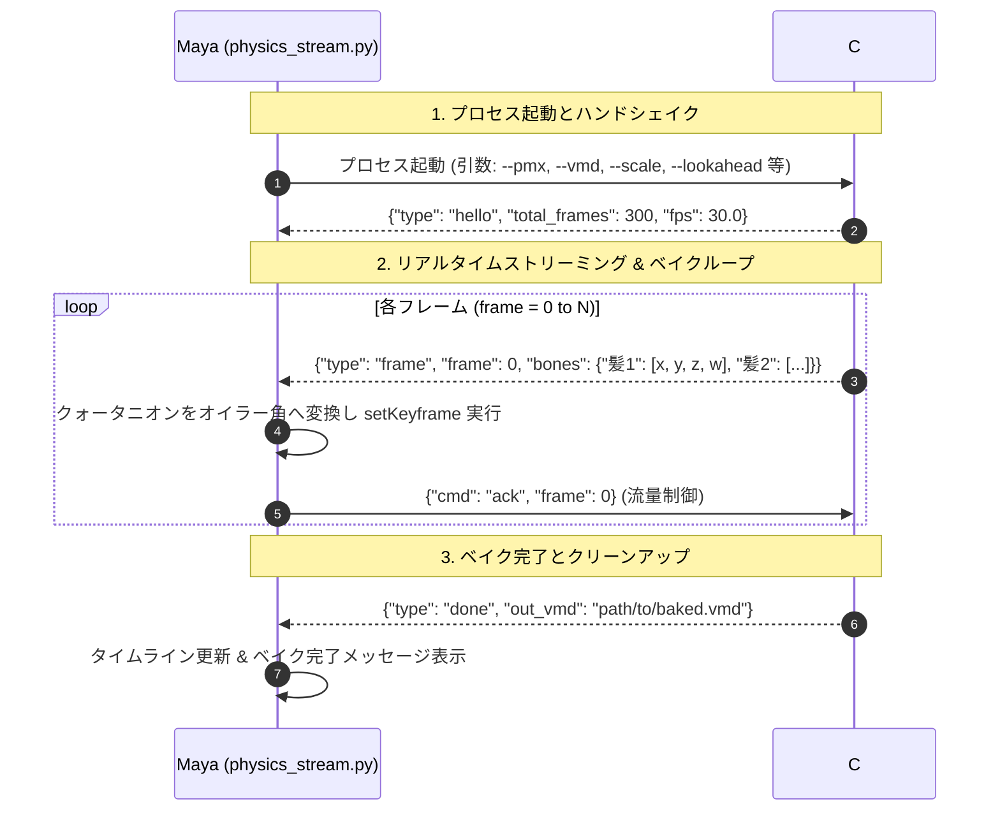

# MMD物理演算リアルタイムベイク技術仕様書 (bullet_engine ✕ physics_bake_cs)

> [!NOTE]
> 本詳細技術仕様書は、AI によって作成・整理されたドキュメントです。内容はソースコードおよび開発記録をもとに記述していますが、実際の動作と細部が異なる場合があります。

本ドキュメントは、「MMD Tools for Maya」において、C++ Bullet 物理演算モジュール（`bullet_engine`）の数理モデルと C# (.NET 8 / WPF 3D / BulletSharp) アプリケーション（`physics_bake_cs`）を統合し、プロセス間通信（IPC）を通じて Autodesk Maya へ高速に物理ベイク情報をリアルタイム送信・記録するアーキテクチャの技術仕様書です。

---

## 1. 開発背景とアーキテクチャ設計思想

### 1-1. 従来の Maya 内物理ベイクが抱える課題

従来、Autodesk Maya の内部（Python / OpenMaya API）で剛体物理シミュレーションをステップ実行する場合、以下の深刻なボトルネックが存在していました：

- **ビューポート描画オーバーヘッド**: Maya のタイムラインを1フレームずつ進めるたびに、スキンクラスタ（デフォーマー）、高解像度テクスチャ、ライティング、シェーダー全体の再評価・再描画が強制され、シミュレーション速度が極端に低下する。
- **Python の GIL および型変換コスト**: 大量ボーン・剛体を持つモデルにおいて、Python レイヤーでの行列計算やループ処理がボトルネックとなり、長時間のベイク処理を要する。

### 1-2. 外部プロセス分離（ハイブリッド・パイプライン）の採用

本ツールでは、物理シミュレーションおよびポーズ評価の計算処理を **C# (.NET 8 / BulletSharp) の独立スタンドアロンプロセス (`PhysicsSimulationBakeViewer.exe`)** へすべてオフロードするアーキテクチャを採用しました。

これにより、Maya 側のシーン描画負荷から物理演算を切り離し、WPF 3D による軽量なリアルタイム可視化を行いながら、シミュレーション結果をストリーミングで Maya へ転送・キーフレーム記録する超高速パイプラインを実現しています。

---

## 2. `bullet_engine` と `physics_bake_cs` の統合数理モデル

### 2-1. MMD 本家準拠の Bullet 物理仕様の継承

本ツール内包の C++ エンジン `bullet_engine`（Bullet Physics 2.83.7）と同一の物理演算挙動を C# 上で再現するため、.NET 8 環境でネイティブ Bullet ラッパーである **BulletSharp** を採用しています。

- **剛体形状**: 球（Sphere）、箱（Box）、カプセル（Capsule）の3種をサポート。
- **拘束条件 (Generic6DofSpringConstraint)**:
  - 6自由度（並進 X/Y/Z、回転 X/Y/Z）の制限範囲（LowerLimit / UpperLimit）設定。
  - 各軸のスプリング剛性係数（SpringStiffness）およびダンピング特性の設定。
- **衝突グループとマスクフィルタリング**:
  - MMD 特有の 16 グループ（1〜16）および 16bit 非衝突マスクによるビット演算フィルタリングを忠実に再現。
- **物理パラメータのスケール整合**:
  - MMD 空間（1.0 単位）と Maya 空間（デフォルト 8.0 倍スケール）の差異を吸収するスケーリング行列変換を内蔵。

### 2-2. PMX 剛体種別に応じたシミュレーション分岐

PMX 剛体の 3 つの動作モードを以下の通り厳密に評価します：

- **ボーン追従 (Kinematic / 0)**:
  - ボーンのアニメーション（FK・IK・付与親）のワールド姿勢を毎フレーム剛体のトランスフォームへ直接反映。動的な反作用は受けず、他の剛体を押しのけるコライダーとして機能。
- **物理演算 (Dynamic / 1)**:
  - 重力、外力、スプリング拘束、コライダーとの衝突計算に基づき、Bullet ソルバーがダイナミクスを算出。
- **物理演算＋位置合わせ (Dynamic With Bone Alignment / 2)**:
  - 剛体の並進位置はボーンのワールド位置に吸着させつつ、回転のみを物理演算結果から適用。主に根元剛体や髪の基部に適用される MMD 独自の安定化挙動を再現。

---

## 3. 高速ボーンポーズ評価とクォータニオン逆算 (`PoseEvaluator.cs`)

外部プロセス側で物理剛体を正確に追従させるには、各フレームにおけるベースアニメーションのボーン姿勢を正確に把握する必要があります。`physics_bake_cs` は、自前で高速なポーズ評価器（`PoseEvaluator`）を実装しています。

### 3-1. 順方向キネマティクス (FK) と付与親の高速計算

- **親子階層のトポロジカル順評価**:
  - ルートボーンから末端ボーンへ向かい、親のワールド行列と子のローカル変換（VMD キーフレームの補間値）を順次積算。
- **付与親ボーンの解決**:
  - 回転付与・移動付与フラグおよび付与率に基づき、変形階層順に姿勢をリアルタイム合成。
- **足IKの解析的ソルブ**:
  - 2ボーンIKおよび多段IKチェーン（つま先・足首・ひざ）を高速評価し、脚ポーズを決定。

### 3-2. 物理剛体行列からのローカルクォータニオン逆算

物理シミュレーションによって確定した剛体のワールド変換行列 $M_{rb}^{world}$ から、対象ボーンが持つべきローカル回転クォータニオン $q_{local}$ を以下の手順で逆算します：

1. **剛体オフセットの相殺**:
   PMX の剛体位置・回転オフセット行列 $M_{offset}$ を用い、ボーンの物理ワールド行列 $M_{bone\_phys}^{world}$ を算出：
   $$M_{bone\_phys}^{world} = M_{rb}^{world} \times (M_{offset})^{-1}$$
2. **親ボーン空間への変換**:
   親ボーンのワールド変換行列 $M_{parent}^{world}$ の逆行列を乗算し、ローカル変換行列 $M_{local}$ を抽出：
   $$M_{local} = (M_{parent}^{world})^{-1} \times M_{bone\_phys}^{world}$$
3. **回転クォータニオンの抽出**:
   $M_{local}$ の回転成分から正規化クォータニオン $(q_x, q_y, q_z, q_w)$ を数学的に抽出し、Maya への送信データとしてパッキング。

---

## 4. Maya へのリアルタイム送信パイプライン (`physics_stream.py` ↔ `ViewerWindow.xaml.cs`)

### 4-1. プロセス間通信プロトコル (JSON Lines over Stdin/Stdout)

複雑なネットワーク設定やポート競合を避けるため、標準入出力（stdin / stdout）を通じた **JSON Lines (1行1JSON)** によるストリーミング通信を採用しています。



### 4-2. 通信メッセージ仕様

- **初期化メッセージ (C# → Maya)**:
  ```json
  {
    "type": "hello",
    "total_frames": 1800,
    "fps": 30.0,
    "physics_bones_count": 84
  }
  ```
- **フレームデータメッセージ (C# → Maya)**:
  各物理ボーンの名称と、逆算されたローカル回転クォータニオン `[qx, qy, qz, qw]` のマッピング：
  ```json
  {
    "type": "frame",
    "frame": 120,
    "bones": {
      "左髪1": [0.012, 0.045, -0.003, 0.998],
      "スカート前1": [-0.15, 0.002, 0.01, 0.988]
    }
  }
  ```
- **流量制御 ACK (Maya → C#)**:
  ```json
  { "cmd": "ack", "frame": 120 }
  ```
- **中断リクエスト (Maya → C#)**:
  ユーザーがログダイアログの「キャンセル」を押下した際に送信：
  ```json
  { "cmd": "cancel" }
  ```
- **完了通知 (C# → Maya)**:
  ```json
  {
    "type": "done",
    "baked_frames": 1800,
    "out_vmd": "C:/path/to/motion_baked.vmd"
  }
  ```

### 4-3. スライディングウィンドウによる流量制御（バックプレッシャー）

C# 側の剛体シミュレーションは極めて高速（秒間数百フレーム以上）である一方、Maya 側の `setKeyframe` 処理は Maya シーンの複雑さに応じて処理速度が変動します。

バッファオーバーフローやメモリ圧迫を防ぐため、`lookahead` パラメータ（デフォルト 16フレーム）を用いたスライディングウィンドウ制御を実装しています。Maya からの `ack` が遅延した場合、C# 側は先行フレーム数を制限して待機し、両プロセスの同期を安定して維持します。

### 4-4. Maya 側のキーフレーム書き込み最適化 (`physics_stream.py`)

- **クォータニオンからオイラー角への最短変換**:
  Maya のボーン回転順序（RotateOrder）を考慮し、前フレームとの最短角度補間（アンロール処理）を適用してオイラー角（Degree）を算出。
- **ベイク済み VMD の自動同時保存**:
  シミュレーション終了時、Maya へのキーフレーム記録と並行して、C# 側で物理結果を焼き込んだ単体 VMD ファイル（`*_physics_baked.vmd`）を自動生成。他のプロジェクトや外部ツールへの再利用を可能にしています。(未確認)

---

## 5. 本アーキテクチャの実効性能と効果

1. **シミュレーション速度の劇的向上**:
   Maya のビューポート描画ループから物理演算を分離したことで、従来の内部ベイクと比較して **10倍〜30倍以上の高速ベイク** を達成。
2. **作業中の高い視認性と安定性**:
   独立した WPF 3D 画面上で揺れもののリアルタイムな挙動を確認できるため、破綻やパラメータの違和感を即座に把握可能。
3. **Maya UI の応答性維持**:
   非同期プロセス間通信により、長時間の物理ベイク中も Maya 本体のプログレスバーやキャンセル操作が軽快に応答。

---

## 6. 剛体貫通防止強化アーキテクチャ

激しいダンスや足の蹴り出しモーションにおいて、スカートと足などの剛体が突き抜けてめり込んでしまう現象を抑制するため、以下の物理シミュレーション強化機構を組み込んでいます。

### 全剛体に対するCCD（連続衝突判定）の有効化
- 物理剛体（Dynamic）だけでなく、足や体などのボーン追従剛体（Kinematic）に対してもCCD（Swept Sphereによる移動軌跡判定）を適用。
- 形状サイズに応じた移動閾値（`CcdMotionThreshold`）および安全球半径（`CcdSweptSphereRadius`）を設定し、1ステップあたりの高速移動によるコライダーの飛び越え（トンネリング現象）を防止。

### ボーン追従剛体の移動速度（LinearVelocity）算出と反発インパルス伝達
- ボーン追従剛体の姿勢更新時、前フレームのワールド位置からの移動差分（$\Delta Pos / \Delta t$）を算出し、剛体へ線速度として付与。
- これにより、Bulletの衝突解決処理において足の移動インパルスが物理剛体（スカート等）へ力強く伝達され、接触時にスカートが外側へ滑らかに押し出される挙動を実現。

### 拘束ソルバーの反復回数引き上げとSplit Impulse導入
- ソルバーの反復回数をデフォルトの10回から **25回** に引き上げ、多数のジョイントが網目状に連動するスカート等の拘束網の剛性と安定性を強化。
- めり込み発生時に剛体が吹き飛ぶのを防ぎ、滑らかな位置補正インパルスで復元する **Split Impulse**（`SplitImpulse = 1`、貫通閾値 `-0.04f`）を有効化。

### 内部計算レートの高精度化（120Hz〜240Hzサブステップ対応）
- 物理シミュレーションの内部固定時間刻みを従来の60Hz（約16.6ms）から **120Hz（約8.3ms、デフォルト）** および **240Hz（約4.1ms、激しいモーション用）** へ高精度化。
- 1フレーム（1/30秒）の間に最大16〜24回の微細サブステップで衝突計算を反復実行することで、足の1ステップあたりの移動量を微小化し、薄い剛体同士の貫通を物理的に抑制。

### Maya側GUIおよびストリーミング引数連携
- Maya側の「物理演算ベイク」タブに「精度 (貫通防止):」コンボボックス（高精度 120Hz / 超高精度 240Hz / 標準 60Hz）を設置。
- ベイク実行時にコマンドライン引数 `--substep`（または `--substep-hz`）を経由して独立プロセス側へ動的に伝達。

---

## 7. 外部物理ビューアの自動カメラ配置およびモデル動的追尾仕様

物理シミュレーションを視覚的に確認する外部ビューア（WPF 3D）において、モデルが画面外へ見切れたり背を向けたりすることなく、常に正面から最適なアングルで被写体を捉え続ける自動フレーミング機構を搭載しています。

- **カメラの正面自動正対配置**:
  - MMD座標系におけるモデルの正面方向（Z正方向、オイラー角180度アングル）を基準とし、モデルの正面に対峙する位置へカメラの初期トランスフォームを自動配置。
  - モデルの背面や逆アングルから開始される視点破綻を防止。
- **モデル全高解析に基づく注視点（LookAt）および引き構図の自動算出**:
  - PMXモデルのバウンディングボックスおよび初期ジョイント座標からモデル全体の全高（$H$）を算出。
  - モデル全高の約52%の位置（みぞおちから腰付近）を注視目標点（LookAt Target: $Y = 0.52 \times H$）として定義。
  - カメラ距離をモデル全高の **2.35倍**（最小22.0）に設定し、頭頂部から足元・広がるスカートまで、キャラクター全身がゆとりを持って自然に画角中央へ収まる引きの構図を確立。
- **歩行・長距離移動モーションの動的カメラ追尾**:
  - ダンスや歩行アニメーションにおいてモデルがシーン内を大きく移動する際、センターボーン（またはルートボーン）のワールド座標変位をリアルタイムにサンプリング。
  - カメラの注視点および視点座標に対してモデルの移動ベクトルを同調適用。
  - モデルが画面外へフェードアウトすることなく、常に画角の中央で揺れものの挙動を安定して観察可能。

---

## 8. CLIモードにおけるヘッドレス実行とライフサイクル管理仕様

バッチ処理やスクリプト自動化、Mayaバックグラウンド実行を支援するため、ヘッドレス環境に最適化されたCLIライフサイクルを実装しています。

- **GUIダイアログの抑制**:
  - コマンドライン引数 `--cli`（または `--headless`）の指定時、エラー・警告等のポップアップダイアログ表示を抑止し、標準エラー出力（stderr）およびJSONストリーム（stdout）へ構造化ログを出力。
- **キャンセルコマンド受信時の即時クリーンアップ**:
  - Maya側から `{"cmd": "cancel"}` を受信した際、Bulletシミュレーションスレッドおよびストリーミングループを直ちに停止。
  - 未完了テンポラリファイルの削除およびプロセスリソースの即時解放を行い、ゾンビプロセスの残存を防止。

---

## 複数モデル順次物理ベイク仕様 (追突防止アイソレーション方式)

同一シーン内に複数のMMDモデルが存在する制作環境において、モデル同士が重なり合った際の剛体・ジョイント追突（反発や吹き飛び）を防止するための順次ベイク仕様です。

- **アイソレーション順次実行アーキテクチャ**:
  - 同一シミュレーション空間に複数モデルを同時に読み込む方式を排し、モデルごとに独立した物理ビューアプロセス（`PhysicsSimulationBakeViewer.exe`）を1体ずつ順次起動。
  - 各モデルは自身の剛体・ジョイントのみが存在する独立空間でシミュレーションされ、キーフレームがMayaシーン上の対応ボーンへ書き込まれるため、モデル同士の衝突干渉が一切発生しない。
- **自動検出によるシームレスな順次ベイク**:
  - 「適用対象モデル」を「自動検出 (シーン内のMMDモデル)」に設定した状態でベイクを実行すると、シーン内に存在するモデル数を自動判別。
  - 検出されたモデルが1体の場合は単体ベイク、2体以上の場合は自動的にアイソレーション順次ベイクを実行。個別モデルが選択されている場合は当該モデル1体のみをベイク。
  - 開始フレーム、終了フレーム、先行フレーム数、安定化時間、スケール倍率、貫通防止精度等のメイン設定値がそのまま全モデルへ引き継がれる。
- **ベイク対象モデル一覧の確認 (`MultiModelPhysicsBakeDialog`)**:
  - 「ベイクするモデルの確認」ボタンからダイアログを起動し、これからベイクされる対象モデル（単体・複数問わず）の表示名、Mayaノード名、PMXパス、ベイク対象状態を一元確認可能。


