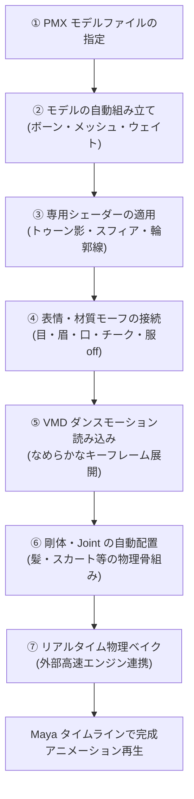
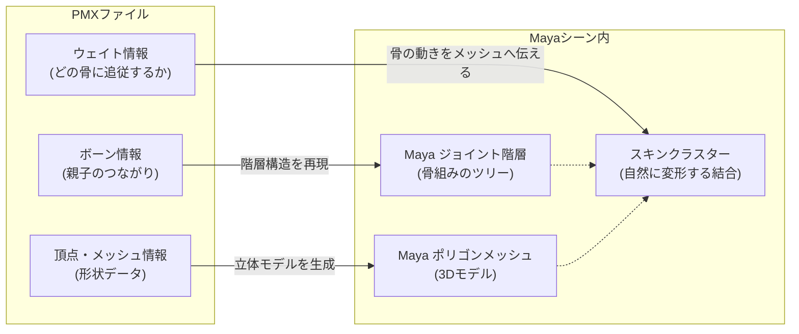
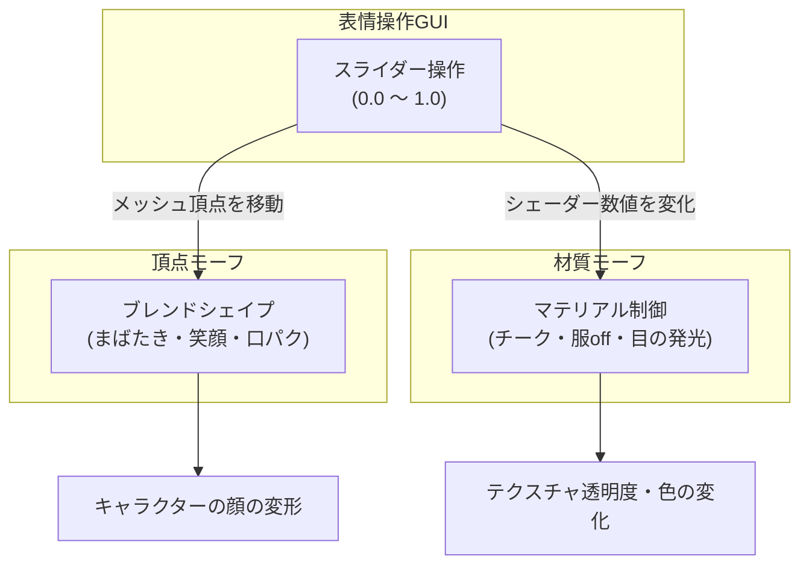
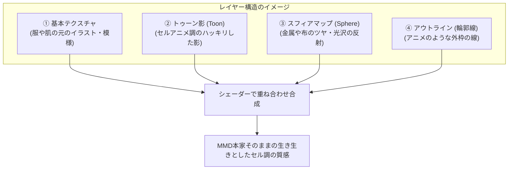
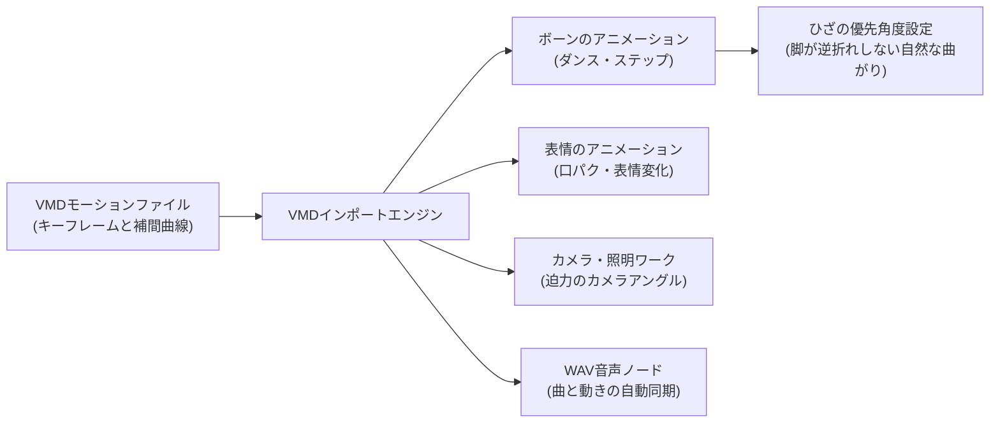
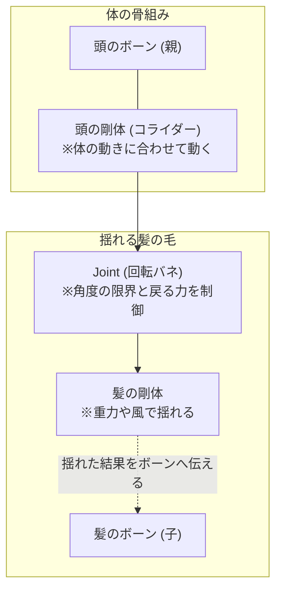
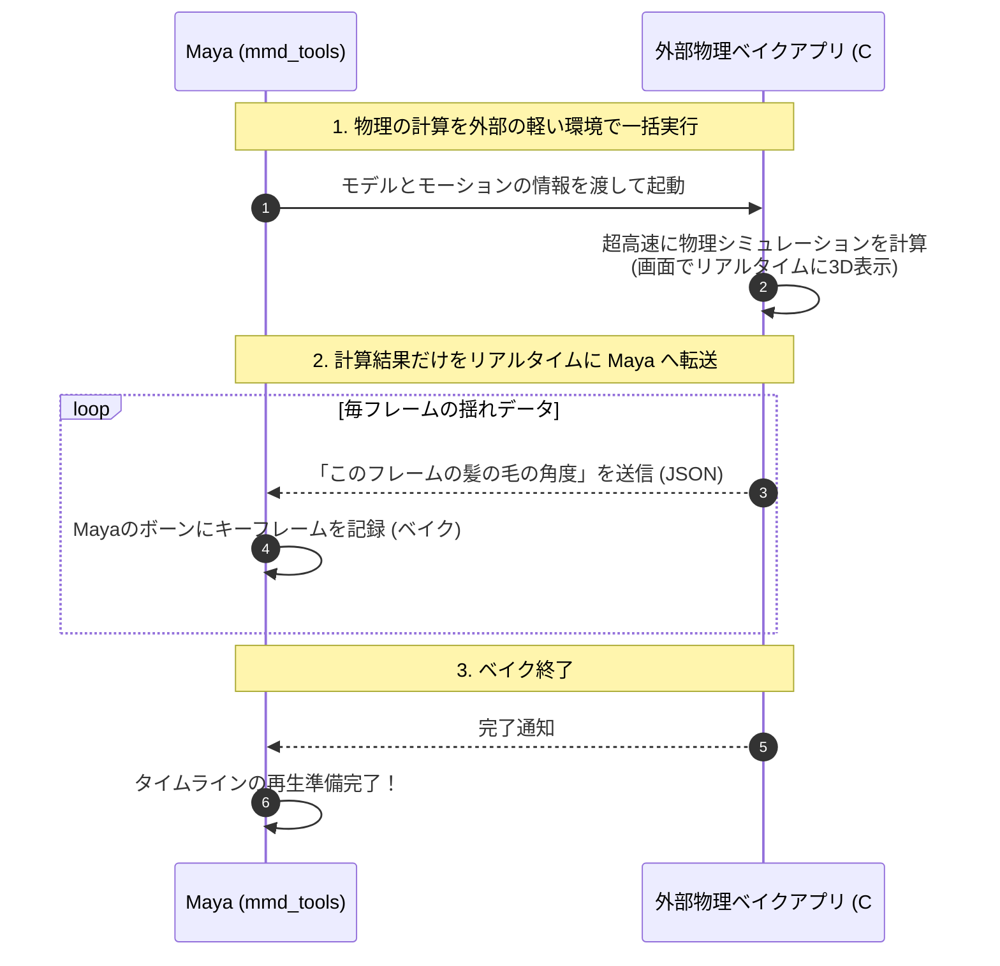

# MMD Tools for Maya 技術仕様書: インポートから物理演算ベイクまでの仕組み解説

> [!NOTE]
> 本詳細技術仕様書は、AI によって作成・整理されたドキュメントです。内容はソースコードおよび開発記録をもとに記述していますが、実際の動作と細部が異なる場合があります。

本ドキュメントは、「MMD Tools for Maya」が MMD のキャラクターモデル（PMX）やモーション（VMD）を読み込み、Maya 上で自然なアニメーションや物理シミュレーションを再現するまでの一連の仕組みを、数式を使わずに分かりやすく図解した技術仕様書です。

各セクションの末尾には、数学的な計算式や内部のプログラム構造をより深く解説した専門ドキュメントへのリンクを用意しています。目的に応じてご活用ください。

---

## 1. 全体パイプラインの流れ

本ツールは、モデルの読み込みからアニメーション、物理演算の焼き付け（ベイク）まで、以下の流れでスムーズに処理を進めます。

---

## 2. モデル（PMX）のインポートと組み立て

PMX ファイルを読み込むと、Maya の中に「骨（ボーン）」「外見（メッシュ）」「骨と皮膚をつなぐ情報（ウェイト）」が順番に自動構築されます。

- **ボーン（骨組み）の作成**: キャラクターの中心（センター）から手足・指先・髪の毛に至るまで、正しい親子関係を持ったジョイント階層を自動生成します。
- **メッシュの復元**: モデルの頂点座標や三角形ポリゴンを Maya のメッシュとして展開します。
- **ウェイト（スキニング）の設定**: 腕を曲げたときに肘周りの皮膚がなめらかに曲がるよう、ボーンと頂点の引っ張り度合い（ウェイト値）を精密に関連付けます。
- **PMD モデルの自動変換**: 旧形式の PMD ファイルを指定した場合は、PMX 2.0 形式へ変換して同じフォルダに保存し、PMX として読み込むことができます。
- **複数モデルの読み込み（試験的機能）**: 複数の PMX / PMD をリストやドラッグ＆ドロップで登録し、モデルごとに用意されたアンカー（目印のロケーター）の位置へ順番に配置します。
- **足IKの組み立て**: 「足 → ひざ → 足首」に Maya の IK ハンドルを作成し、足首の向きは足IKボーンの回転にそのまま追従します。つま先はつま先IKボーンの回転に追従します。

> [!TIP]
> **詳しい仕様や数式・スキニングアルゴリズムはこちらをご覧ください:**  
> [model_import_specification.md](model_import_specification.md)

---

## 3. 表情モーフと材質モーフの仕組み

キャラクターの豊かな感情表現やパーツの切り替えは、「頂点モーフ」と「材質モーフ」の2つの仕組みで再現されます。

- **頂点モーフ（ブレンドシェイプ）**: 目やまゆ、口の頂点を動かして表情を作ります。Maya 標準のブレンドシェイプ機能として登録されるため、キーフレーム操作がとても簡単です。
- **材質モーフ（色の変化やパーツ切り替え）**: 照れ顔（チーク）を出したり、帽子や服を一時的に非表示（透明化）にしたりする設定です。単に透明にするだけでなく、消したパーツの輪郭線（エッジ）や影だけが空中に残ってしまわないよう、光の反射や輪郭線の太さも自動で一緒に変化させます。

> [!TIP]
> **詳しい仕様やモーフ計算・属性接続はこちらをご覧ください:**  
> [model_import_specification.md](model_import_specification.md)

---

## 4. MMD専用シェーダー（見た目の再現）

Maya にモデルを読み込んだ際、通常の CG シェーダーのままだと「白飛びする」「暗すぎる」「アニメ調に見えない」といった現象が発生します。本ツールでは、MMD 専用の Viewport 2.0 シェーダープラグインを用いて本家に近い見た目を再現します。

- **MMD Toon Shader（`mmd_toon_shader.mll`）**: インポート時の標準マテリアルです。OGSFX 形式の C++ シェーダーノード（`mmdToonShader`）で、トゥーン・スフィア・セルフシャドウを MMD の計算式に沿って合成します。
- **MMD Material（`mmd_material.mll`）**: もう一つの MMD 専用シェーダーノード（`mmdMaterial`）で、マテリアル種別の選択で切り替えられます。

- **トゥーン影**: 光が当たっている面と影になる面を段階的に塗り分け、アニメ調のくっきりした陰影を作り出します。
- **スフィアマップ**: 視線に合わせてハイライトや光沢がキラリと動く効果を加えます。
- **二重構造の透過**: 髪の毛の下から透ける眉毛や、薄いベール、頬のチークなどが黒ずんだりチラついたりせず、自然なグラデーションで綺麗に透き通るよう設計されています。
- **顔透過メッシュの受光遮断**: チークや涙などの透過板ポリゴンが不要な光や影を拾って白枠線や四角い影が浮き出ないよう自動で最適化します。

> [!WARNING]
> **【モデル依存に関する注意点】**:  
> 材質モーフ（服offや頬染め等）や顔透過メッシュの白枠線抑制は、モデル制作者様によるマテリアルの設計やテクスチャのアルファ構造、法線の向きによって、正しく表示・連動できない場合があります。

> [!TIP]
> **詳しい仕様やシェーダーの内部構造・HLSLコードはこちらをご覧ください:**  
> [mmd_material_plugin_specification.md](mmd_material_plugin_specification.md)

---

## 5. ダンスモーション（VMD）とカメラ・音声の適用

MMD のダンスモーション（VMD）を読み込むと、タイムライン上に滑らかなアニメーションキーフレームが展開されます。

- **なめらかな加減速（補間曲線）**: 動き出しがゆっくりで、途中で速くなり、ピタッと止まるといった MMD 特有のリズム（イーズイン・イーズアウト）を忠実にカーブとして再現します。
- **ひざジョイントの優先角度（逆折れ防止）**: ダンスで深くしゃがんだりジャンプしたりした際、ひざが後ろ向きや横方向に不自然に曲がってしまうトラブル（逆関節現象）を防ぐため、あらかじめ「前に自然に曲がる優先角度」を自動で指定して安定させます。

> [!TIP]
> **詳しい仕様やオイラー角変換・補間曲線の計算はこちらをご覧ください:**  
> [vmd_import_specification.md](vmd_import_specification.md)

---

## 6. 剛体と Joint（物理の骨組み）の構築

スカートや長い髪の毛、リボンなどを自然にふわふわと揺らすために、「剛体（当たり判定カプセル）」と「Joint（関節・バネ）」を配置します。

- **剛体（コリジョンカプセル）**: 丸やカプセル型の当たり判定です。キャラクターの頭や体のように「アニメーションに合わせて動く剛体（コライダー）」と、髪の毛のように「重力や揺れで動く剛体」の2種類があります。
- **Joint（バネ・拘束）**: 剛体同士をつなぐ関節です。「ここまでは曲がって良い」「曲がったら元の形に戻ろうとする」というバネの強さを設定して、髪やスカートが暴れすぎたり逆立ちしたりするのを防ぎます。

> [!TIP]
> **詳しい仕様や剛体追従・コライダー生成の構造はこちらをご覧ください:**  
> [physics_system_specification.md](physics_system_specification.md)  
> [bullet_engine_specification.md](bullet_engine_specification.md)

---

## 7. 超高速リアルタイム物理ベイクの仕組み

Maya の中で物理シミュレーションを動かすと、1コマ進めるたびに Maya 全体の描画が走るため処理が重くなります。本ツールでは、この計算を **外部の専用アプリ（C# / .NET 8 / Bullet）** に担当させることで高速化しています。

- **Bullet のバージョン選択**: 「Bullet 2.75（本家 MMD 採用・挙動再現重視）」と「Bullet 2.83.7（安定性・貫通防止重視）」を GUI から選べます。外部ビューアはバージョンごとに別の実行ファイル（`PhysicsSimulationBakeViewer_275.exe` / `PhysicsSimulationBakeViewer_283.exe`）として用意されています。
- **複数モデルの順次ベイク**: シーンに複数のモデルがある場合、モデル同士の剛体がぶつかり合わないよう 1 体ずつ独立して計算・ベイクします。

- **なぜ軽くて速いのか？**: Maya の重い画面描画（高解像度テクスチャや複雑なリグ）から物理計算を切り離し、専用の高速エンジンで計算を行うため、Maya が固まることなくスムーズに処理が進みます。
- **リアルタイムな安心プレビュー**: 計算の様子は独立した専用ビューア画面で軽快に 3D 表示されるため、髪やスカートがどのように揺れているかを目で確認しながらベイクできます。
- **タイムラインへの記録（ベイク）**: 物理で揺れた結果がすべて Maya のキーフレームとして記録されるため、ベイク後は通常の Maya アニメーションとしていつでも好きな速度で再生・レンダリングできます。

> [!TIP]
> **詳しい仕様やプロセス間通信プロトコル・逆算数学はこちらをご覧ください:**  
> [realtime_physics_bake_specification.md](realtime_physics_bake_specification.md)

---

## 8. 詳細技術仕様書リンク集

本ツールを構成する各技術の詳細な数理モデル、内部アーキテクチャ、ソースコード仕様をご覧になりたい場合は、以下の各専門ドキュメントをご参照ください。

| ドキュメント名 | 概要・専門解説内容 |
| :--- | :--- |
| [codebase_architecture_specification.md](codebase_architecture_specification.md) | **コードベース全体構成**: 全ディレクトリ・モジュールの責務と設計原則 |
| [model_import_specification.md](model_import_specification.md) | **モデルインポート・質感仕様**: PMX構造、SDEFスキニング、材質モーフ連動 |
| [mmd_material_plugin_specification.md](mmd_material_plugin_specification.md) | **MMD専用シェーダー仕様**: Viewport 2.0 C++ プラグイン、HLSLコード、透過処理 |
| [vmd_import_specification.md](vmd_import_specification.md) | **VMDモーション仕様**: ベジェ補間曲線計算、ひざ優先角度、カメラ・音声同期 |
| [realtime_physics_bake_specification.md](realtime_physics_bake_specification.md) | **リアルタイム物理ベイク仕様**: `bullet_engine` ✕ `physics_bake_cs` 連携、JSON通信 |
| [physics_system_specification.md](physics_system_specification.md) | **Maya物理システム仕様**: ビューポートコライダー生成、追従階層、自動再吸着 |
| [bullet_engine_specification.md](bullet_engine_specification.md) | **Bullet物理エンジン仕様**: Bullet 2.75 / 2.83.7 C++ エンジン、剛体・拘束パラメータ |
| [xpbd_engine_specification.md](xpbd_engine_specification.md) | **自作XPBD物理仕様**: 位置ベース物理（XPBD）ソルバー、サブステップ積分 |
| [pmx_analyzer_specification.md](pmx_analyzer_specification.md) | **モデル詳細解析 & 辞書仕様**: 内部データ一括保存、未登録漢字の抽出とGUI登録 |
| [plugin_technical_guide.md](plugin_technical_guide.md) | **プラグイン技術解説ガイド**: 内部スクリプトの役割解説と運用ハンドブック |
