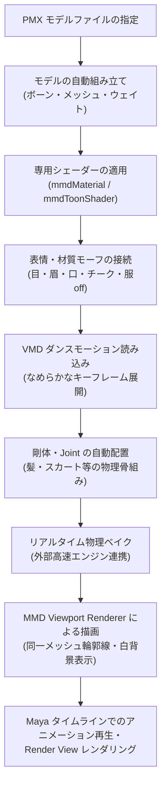
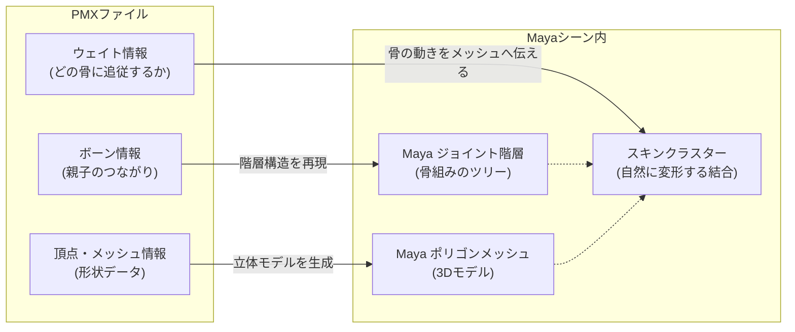
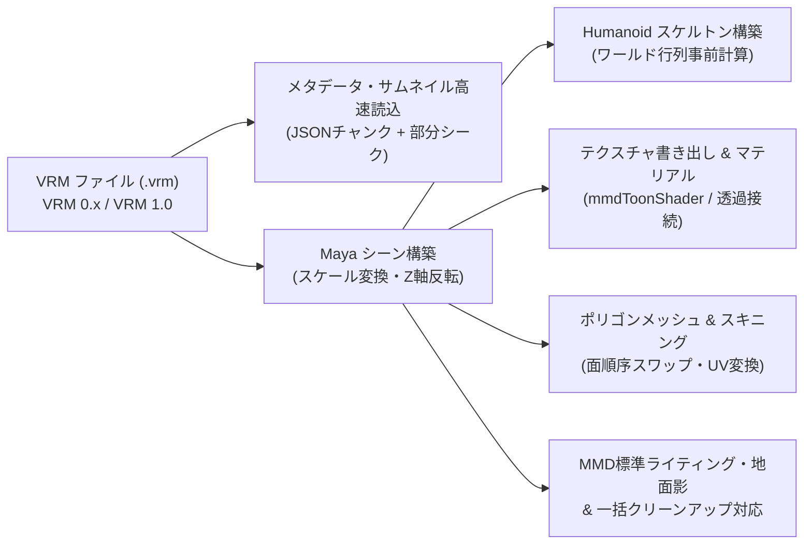
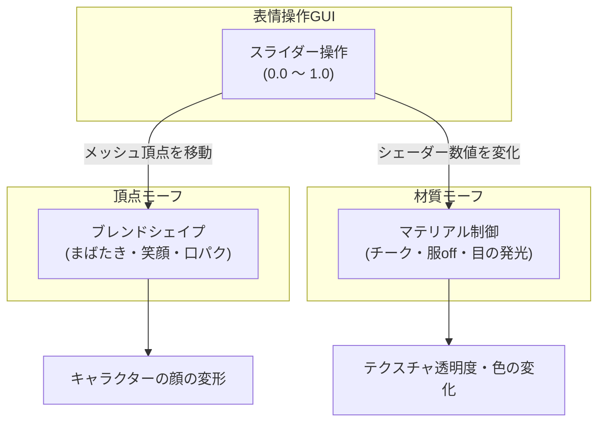
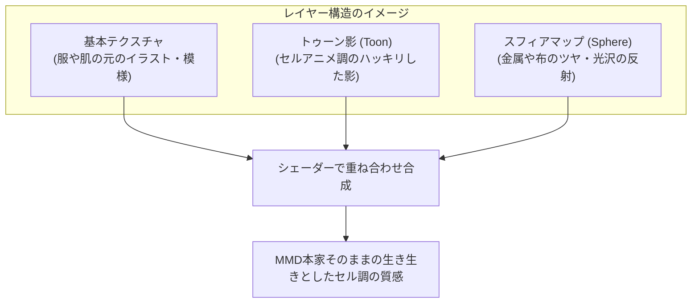
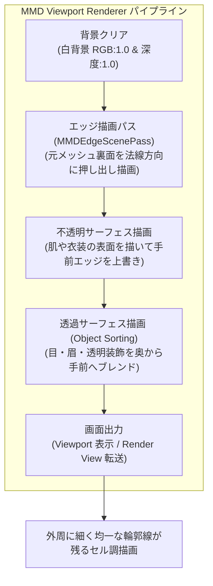
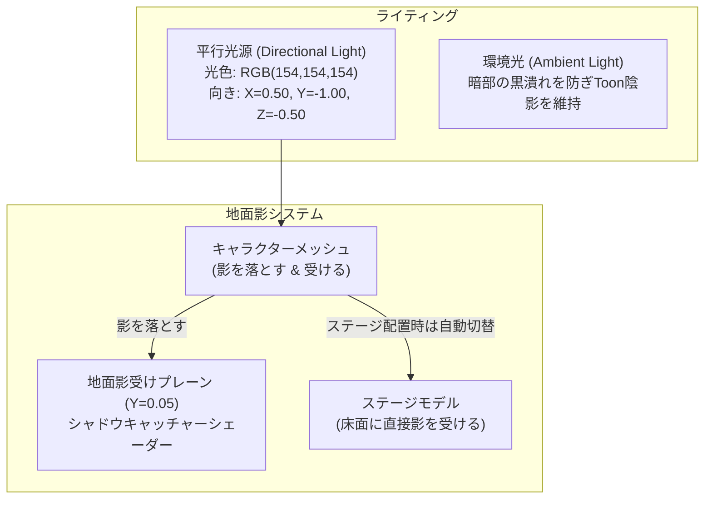
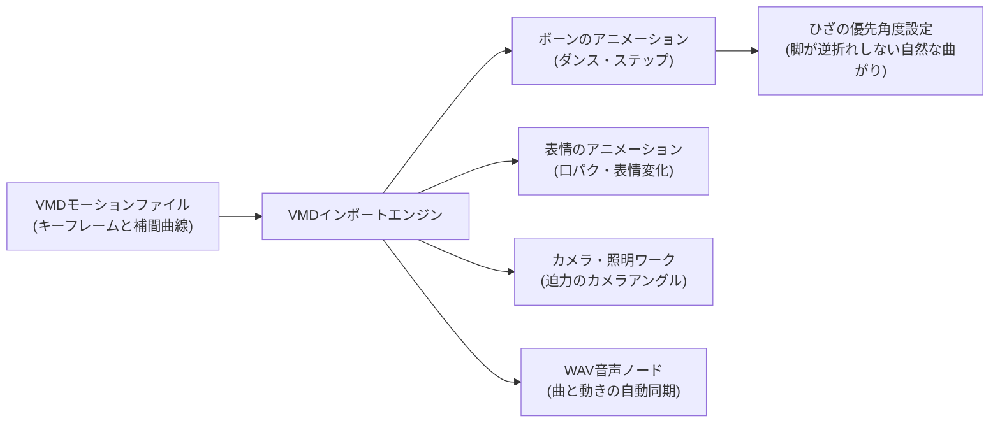
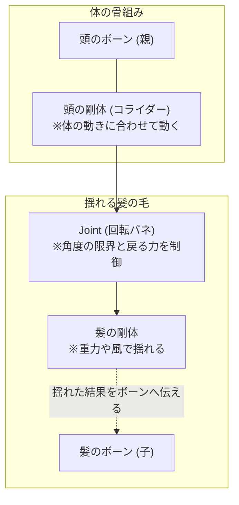
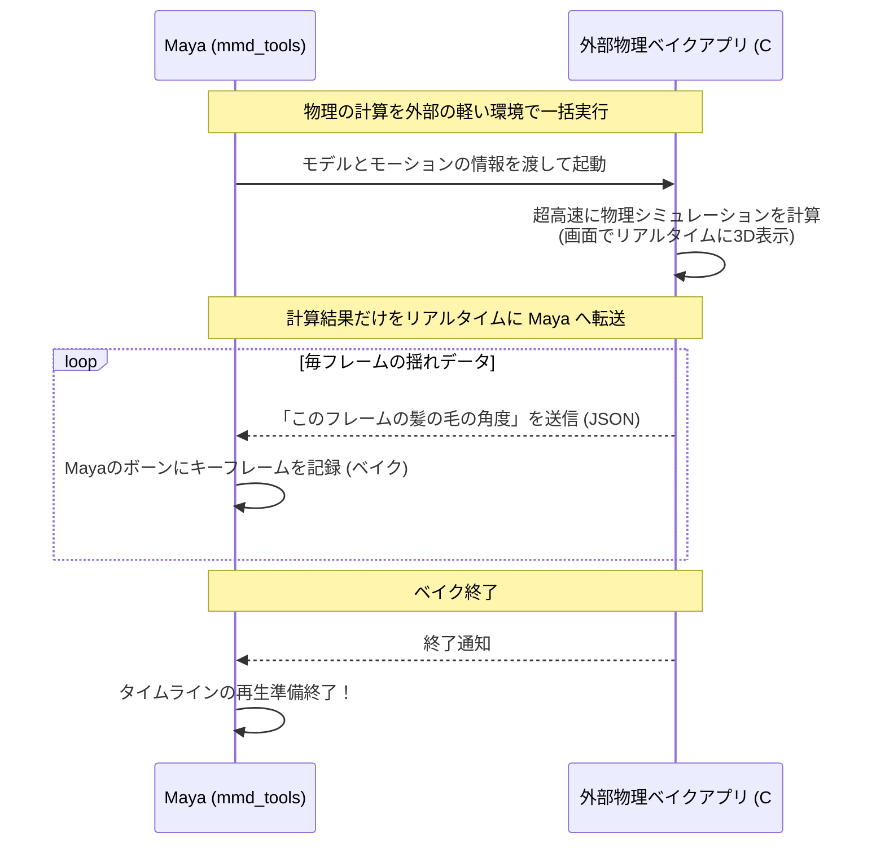

# MMD Tools for Maya 技術仕様書: インポートから物理演算ベイクまでの仕組み解説

> [!NOTE]
> 本詳細技術仕様書は、AI によって作成・整理されたドキュメントです。内容はソースコードおよび開発記録をもとに記述していますが、実際の動作と細部が異なる場合があります。

本ドキュメントは、「MMD Tools for Maya」が MMD のキャラクターモデル（PMX）やモーション（VMD）を読み込み、Maya 上で自然なアニメーションや物理シミュレーションを再現するまでの一連の仕組みを、数式を使わずに分かりやすく図解した技術仕様書です。

各セクションの末尾には、数学的な計算式や内部のプログラム構造をより深く解説した専門ドキュメントへのリンクを用意しています。目的に応じてご活用ください。

---

## 処理パイプラインの概要

本ツールは、モデルの読み込みからアニメーション、物理演算の焼き付け（ベイク）、およびレンダーオーバーライドによる描画まで、以下の流れでスムーズに処理を進めます。

---

## モデル（PMX）のインポートと組み立て

PMX ファイルを読み込むと、Maya の中に「骨（ボーン）」「外見（メッシュ）」「骨と皮膚をつなぐ情報（ウェイト）」が順番に自動構築されます。

- **ボーン（骨組み）の作成**: キャラクターの中心（センター）から手足・指先・髪の毛に至るまで、正しい親子関係を持ったジョイント階層を自動生成します。
- **メッシュの復元**: モデルの頂点座標や三角形ポリゴンを Maya のメッシュとして展開します。
- **ウェイト（スキニング）の設定**: 腕を曲げたときに肘周りの皮膚がなめらかに曲がるよう、ボーンと頂点の引っ張り度合い（ウェイト値）を精密に関連付けます。
- **PMD モデルの自動変換**: 旧形式の PMD ファイルを指定した場合は、PMX 2.0 形式へ変換して同じフォルダに保存し、PMX として読み込むことができます。
- **複数モデルの読み込み（試験的機能）**: 複数の PMX / PMD をリストやドラッグ＆ドロップで登録し、モデルごとに用意されたアンカー（目印のロケーター）の位置へ順番に配置します。
- **足IKの組み立て**: 「足 → ひざ → 足首」に Maya の IK ハンドルを作成し、足首の向きは足IKボーンの回転にそのまま追従します。つま先はつま先IKボーンの回転に追従します。

> [!TIP]
> **詳しい仕様や数式・スキニングアルゴリズムはこちらをご覧ください:**  
> [pmx_model_import_specification.md](pmx_model_import_specification.md) (PMX仕様)  
> [pmd_model_import_specification.md](pmd_model_import_specification.md) (PMD仕様)  
> [x_model_import_specification.md](x_model_import_specification.md) (.x仕様)  
> [pmx-pmd-x_specification.md](pmx-pmd-x_specification.md) (共通構築仕様・フロー図)

---

## その他モデル（VRM）のインポートと組み立て（試験的機能・ベータ版）

v1.0.6 から追加された「その他モデルインポート」ウィンドウ（`ui_other_importer/`）と解析・構築エンジン（`other_converters/vrm_importer.py`）により、MMD 形式以外の 3D アバター形式として **VRM 0.x / VRM 1.0（glTF 2.0 GLB コンテナ）** を Maya へ展開できます。

- **ファイル選択時の高速プレビュー**: 巨大なバイナリ全体を展開せず、先頭の JSON チャンクとサムネイル画像領域だけを部分読み込みして、タイトル・作者・VRM 仕様（0.x / 1.0）・ライセンス・サムネイル画像を即座に表示します。
- **MMD 座標系への統一（Z軸反転・スケール変換）**: glTF（メートル単位）から Maya（センチメートル単位: 既定 100 倍）へ変換し、Z 軸反転時には三角形ポリゴンの頂点順序を入れ替えて裏返りを防ぎます。
- **質感と環境の統一**: 埋め込みテクスチャを自動書き出ししたうえで `mmdToonShader` / `standardSurface` / `lambert` を選択でき、透過素材（瞳・眉・飾り等）の透過配線や MMD 標準ライティング・地面影もあわせて自動構築します。
- **一括クリーンアップタブ**: インポートした VRM モデルと関連ノード（ボーン・マテリアル・テクスチャ・照明・地面影）をまとめて整理できます。

> [!TIP]
> **VRM の GLB バイナリ解析、アクセサ展開、Maya 構築パイプラインの詳細はこちらをご覧ください:**  
> [vrm_model_import_specification.md](vrm_model_import_specification.md)

---

## 表情モーフと材質モーフの仕組み

キャラクターの豊かな感情表現やパーツの切り替えは、「頂点モーフ」と「材質モーフ」の仕組みで再現されます。

- **頂点モーフ（ブレンドシェイプ）**: 目やまゆ、口の頂点を動かして表情を作ります。Maya 標準のブレンドシェイプ機能として登録されるため、キーフレーム操作がとても簡単です。
- **材質モーフ（色の変化やパーツ切り替え）**: 照れ顔（チーク）を出したり、帽子や服を一時的に非表示（透明化）にしたりする設定です。単に透明にするだけでなく、消したパーツの輪郭線（エッジ）や影だけが空中に残ってしまわないよう、光の反射や輪郭線の太さも自動で一緒に変化させます。

> [!TIP]
> **詳しい仕様やモーフ計算・属性接続はこちらをご覧ください:**  
> [pmx_model_import_specification.md](pmx_model_import_specification.md) (モーフ直接書き込み・材質モーフ)

---

## MMD専用シェーダー（質感と陰影の再現）

Maya にモデルを読み込んだ際、通常の CG シェーダーのままだと「白飛びする」「暗すぎる」「アニメ調に見えない」といった現象が発生します。本ツールでは、MMD 専用の C++ プラグイン（`mmd_material.mll`）が提供する 2 種類のシェーディングノードを用いて本家に近い見た目を再現します。

- **MMD Toon Shader (`mmdToonShader`)**:
  インポート時の標準マテリアルです。OGSFX 形式の C++ シェーダーノードで、トゥーン陰影・スフィアマップ・セルフシャドウを MMD 本家の計算モデルに沿って合成します。
- **MMD Material (`mmdMaterial`)**:
  Maya のフラグメントグラフ（`mayaPhongSurface`）を活用したマテリアルノードで、スフィアマップや MMD 固有の反射パラメータを軽快に描画します。

- **トゥーン影**: 光が当たっている面と影になる面を段階的に塗り分け、アニメ調のくっきりした陰影を作り出します。
- **スフィアマップ**: 視線に合わせてハイライトや光沢が動く効果を加えます。
- **二重構造の透過**: 髪の毛の下から透ける眉毛や、薄いベール、頬のチークなどが黒ずんだりチラついたりせず、自然なグラデーションで綺麗に透き通るよう設計されています。
- **顔透過メッシュの受光遮断**: チークや涙などの透過板ポリゴンが不要な光や影を拾って白枠線や四角い影が浮き出ないよう自動で最適化します。

> [!WARNING]
> **【モデル依存に関する注意点】**:  
> 材質モーフ（服offや頬染め等）や顔透過メッシュの白枠線抑制は、モデル制作者様によるマテリアルの設計やテクスチャのアルファ構造、法線の向きによって、正しく表示・連動できない場合があります。

> [!TIP]
> **詳しい仕様やシェーダーの内部構造・数理モデルはこちらをご覧ください:**  
> [mmd_material_plugin_specification.md](mmd_material_plugin_specification.md)

---

## MMD Viewport Renderer と同一メッシュ輪郭線描画の仕組み

キャラクターの輪郭を縁取る黒いエッジ線（アウトライン）は、以前のような「別メッシュ（`_Edge`）の複製」を行わず、元メッシュ単体から裏面を描画する **同一メッシュ方式（MMD本家構造）** によって実現されています。
また、これを破綻なく合成するため、独自のレンダーオーバーライド（`MMDRenderOverride`）が描画順序を制御します。

- **同一メッシュ方式（単一ジオメトリ描画）**:
  シーン内にエッジ専用の余分なメッシュノードを生成しません。元メッシュ単体の頂点データを用い、前面カリング（裏面描画）によって押し出された面を描画するため、リグやスキニングの計算負荷を最小限に抑えます。
- **材質エッジ焼き込みモジュール (`mmd_edge_bake.py`)**:
  モデル内の各材質に設定されたエッジ有効フラグ（`edgeEnable`）や太さ（`edgeSize`）を頂点カラーセット `mmd_edge_scale` へ焼き込みます。目・眉・口などエッジを描画しないパーツの除外や、材質ごとの線幅スケールが自動的に反映されます。
- **Zファイティング（縞模様）および凹面突き抜け防止機構**:
  ハードウェアラスタライザ深度バイアス（`DepthBias = 500` / `SlopeScaledDepthBias = 1.2f`）および頂点シェーダーでのクリップ空間奥方向深度オフセットにより、腕や脚の側面で発生していた黒い縞模様（Zファイティング）や、スカートの谷間・リボンの凹面での黒い塊突き抜けを防止します。
- **均一ピクセル線幅制御**:
  エッジ幅は画面解像度に連動したピクセル単位（既定 `1.5px`）で計算されます。カメラの画角（FOV）や被写体との距離に左右されず、常に均質な輪郭線を保持します。プロジェクション行列要素に対する保護ガードにより画面乱れを防ぎます。
- **Render View（MMD Renderer / `mmdRender`）オフスクリーン描画**:
  カラーバッファと深度バッファの双方（2面）を供給し、さらに透過アルゴリズムに Object Sorting（オブジェクトソート方式）を適用することで、Render View によるオフスクリーンレンダリング時でも目や眉などの透過パーツが白く抜けず、肌色の上に美しくアルファ合成されます。

---

## ライティングと本家MMD地面影（接地感の再現）

MMD特有の生き生きとした立体感と接地感を作り出すため、専用の平行光・環境光および地面影（セルフシャドウ）システムが自動構築されます。

- **本家MMDセルフシャドウ方式による地面影**:
  - キャラクターの足元（Y=0.05）に専用の影受けプレーン（`mmd_ground_shadow_plane`）が自動生成されます。シャドウキャッチャーシェーダーにより、床自体の面色は透明のまま、キャラクターのリアルタイム接地影のみが自然な濃さで描画されます。
  - **ステージモデルとの自動切り替え**: ステージモデルやスカイドームが配置されている場合は、地面影プレーンが自動で非表示になり、ステージ床面自体にキャラクターの影が美しく落ちるよう切り替わります。
- **MMD照明操作GUI（`dialog_light_control.py`）**:
  - MMD本家と同様の操作パネルで、光の色（赤・緑・青）や影の伸びる向き（X, Y, Zスライダー）を直感的に操作できます。初期化ボタンにより、いつでも本家推奨の角度（X: 0.50, Y: -1.00, Z: -0.50）へ復帰できます。

---

## ダンスモーション（VMD）とカメラ・音声の適用

MMD のダンスモーション（VMD）を読み込むと、タイムライン上に滑らかなアニメーションキーフレームが展開されます。

- **なめらかな加減速（補間曲線）**: 動き出しがゆっくりで、途中で速くなり、ピタッと止まるといった MMD 特有のリズム（イーズイン・イーズアウト）を忠実にカーブとして再現します。
- **ひざジョイントの優先角度（逆折れ防止）**: ダンスで深くしゃがんだりジャンプしたりした際、ひざが後ろ向きや横方向に不自然に曲がってしまうトラブル（逆関節現象）を防ぐため、あらかじめ「前に自然に曲がる優先角度」を自動で指定して安定させます。

> [!TIP]
> **詳しい仕様やオイラー角変換・補間曲線の計算はこちらをご覧ください:**  
> [vmd_import_specification.md](vmd_import_specification.md)

---

## 剛体と Joint（物理の骨組み）の構築

スカートや長い髪の毛、リボンなどを自然にふわふわと揺らすために、「剛体（当たり判定カプセル）」と「Joint（関節・バネ）」を配置します。

- **剛体（コリジョンカプセル）**: 丸やカプセル型の当たり判定です。キャラクターの頭や体のように「アニメーションに合わせて動く剛体（コライダー）」と、髪の毛のように「重力や揺れで動く剛体」の2種類があります。
- **Joint（バネ・拘束）**: 剛体同士をつなぐ関節です。「ここまでは曲がって良い」「曲がったら元の形に戻ろうとする」というバネの強さを設定して、髪やスカートが暴れすぎたり逆立ちしたりするのを防ぎます。

> [!TIP]
> **詳しい仕様や剛体追従・コライダー生成の構造はこちらをご覧ください:**  
> [physics_system_specification.md](physics_system_specification.md)  
> [bullet_engine_specification.md](bullet_engine_specification.md)

---

## 超高速リアルタイム物理ベイクの仕組み

Maya の中で物理シミュレーションを動かすと、1コマ進めるたびに Maya 画面の再描画が走るため処理が重くなります。本ツールでは、この計算を **外部の専用アプリ（C# / .NET 8 / Bullet）** に担当させることで高速化しています。

- **Bullet のバージョン選択**: 「Bullet 2.75（本家 MMD 採用・挙動再現重視）」と「Bullet 2.83.7（安定性・貫通防止重視）」を GUI から選べます。外部ビューアはバージョンごとに別の実行ファイル（`PhysicsSimulationBakeViewer_275.exe` / `PhysicsSimulationBakeViewer_283.exe`）として用意されています。
- **複数モデルの順次ベイク**: シーンに複数のモデルがある場合、モデル同士の剛体がぶつかり合わないよう 1 体ずつ独立して計算・ベイクします。

- **なぜ軽くて速いのか？**: Maya の重い画面描画（高解像度テクスチャや複雑なリグ）から物理計算を切り離し、専用の高速エンジンで計算を行うため、Maya が固まることなくスムーズに処理が進みます。
- **リアルタイムな安心プレビュー**: 計算の様子は独立した専用ビューア画面で軽快に 3D 表示されるため、髪やスカートがどのように揺れているかを目で確認しながらベイクできます。
- **タイムラインへの記録（ベイク）**: 物理で揺れた結果がすべて Maya のキーフレームとして記録されるため、ベイク後は通常の Maya アニメーションとしていつでも好きな速度で再生・レンダリングできます。

> [!TIP]
> **詳しい仕様やプロセス間通信プロトコル・逆算数学はこちらをご覧ください:**  
> [realtime_physics_bake_specification.md](realtime_physics_bake_specification.md)

---

## 3D 数学・座標系の背景知識（テクニカルアーティスト向けガイド）

モデルインポート、モーション変換、シェーディング、物理演算の裏側では、**右手座標系（Maya）と左手座標系（MMD）の変換**や、回転表現・メッシュ変形を支える 3D 数学が働いています。本ツールの仕組みを数式レベルで理解したい方向けに、実践的な学習ガイドを用意しています。

- **座標系変換と幾何学**: 右手系／左手系の違い、Z 軸反転に伴うポリゴン巻き順（Winding Order）と法線裏返りの原理、単位系スケール換算。
- **回転とアニメーション数理**: クォータニオン（四元数）とオイラー角の相互変換、ジンバルロック対策、ベジェ補間曲線。
- **シェーディングと物理の数理**: トゥーン陰影・法線押し出しエッジの計算モデル、剛体姿勢の逆算ロジック。

> [!TIP]
> **例題と解答を交えた TA 向け 3D 数学・座標系の詳細解説はこちらをご覧ください:**  
> [ta_math_coordinate_systems_guide.md](ta_math_coordinate_systems_guide.md)

---

## 詳細技術仕様書リンク集

本ツールを構成する各技術の詳細な数理モデル、内部アーキテクチャ、ソースコード仕様をご覧になりたい場合は、以下の各専門ドキュメントをご参照ください。

| ドキュメント名 | 概要・専門解説内容 |
| :--- | :--- |
| [codebase_architecture_specification.md](codebase_architecture_specification.md) | **コードベース構成**: 各ディレクトリ・モジュールの責務と設計原則 |
| [model_import_specification.md](model_import_specification.md) | **モデルインポート総合ポータル**: PMX / PMD / .x 仕様書および共通シーン構築仕様書への案内ハブ |
| [pmx_model_import_specification.md](pmx_model_import_specification.md) | **PMXモデルインポート仕様**: PMX 2.0/2.1構造、スキニング、モーフ高速直接書き込み、材質モーフ制御 |
| [pmd_model_import_specification.md](pmd_model_import_specification.md) | **PMDモデルインポート仕様**: PMD構造、剛体拡張、PMD → PMX自動変換パイプライン |
| [x_model_import_specification.md](x_model_import_specification.md) | **DirectX .xファイル仕様**: トークナイザー、メッシュ・マテリアル抽出、アクセサリアタッチ |
| [vrm_model_import_specification.md](vrm_model_import_specification.md) | **VRMモデル解析・構築仕様**: VRM 0.x / 1.0 (glTF 2.0 GLB) バイナリ解析、サムネイル高速抽出、Maya構築パイプライン |
| [pmx-pmd-x_specification.md](pmx-pmd-x_specification.md) | **共通シーン構築仕様 (フロー図)**: `mmd_parser` × `maya_converters` 連携フロー図、メッシュ・リグ・シェーダー・地面影 |
| [mmd_material_plugin_specification.md](mmd_material_plugin_specification.md) | **MMD専用シェーダー仕様**: Viewport 2.0 統合プラグイン（mmd_material.mll）、エッジ描画パス、透過処理 |
| [vmd_import_specification.md](vmd_import_specification.md) | **VMDモーション仕様**: ベジェ補間曲線計算、ひざ優先角度、カメラ・音声同期 |
| [realtime_physics_bake_specification.md](realtime_physics_bake_specification.md) | **リアルタイム物理ベイク仕様**: `bullet_engine` × `physics_bake_cs` 連携、JSON通信 |
| [physics_system_specification.md](physics_system_specification.md) | **Maya物理システム仕様**: ビューポートコライダー生成、追従階層、自動再吸着 |
| [bullet_engine_specification.md](bullet_engine_specification.md) | **Bullet物理エンジン仕様**: Bullet 2.75 / 2.83.7 C++ エンジン、剛体・拘束パラメータ |
| [xpbd_engine_specification.md](xpbd_engine_specification.md) | **自作XPBD物理仕様**: 位置ベース物理（XPBD）ソルバー、サブステップ積分 |
| [pmx_analyzer_specification.md](pmx_analyzer_specification.md) | **モデル詳細解析 & 辞書仕様**: 内部データ一括保存、未登録漢字の抽出とGUI登録 |
| [plugin_technical_guide.md](plugin_technical_guide.md) | **プラグイン技術解説ガイド**: 内部スクリプトの役割解説と運用ハンドブック |
| [pmm_specification.md](pmm_specification.md) | **MMD プロジェクトファイル (PMM) 解析・インポート技術仕様書**: MMD プロジェクトファイルの解説とMaya への一括インポート・連携パイプライン |
| [ta_math_coordinate_systems_guide.md](ta_math_coordinate_systems_guide.md) | **TA向け 3D数学・座標系マスターガイド**: 右手系／左手系変換、ポリゴン巻き順、クォータニオン、シェーダー・物理数理の実践学習書 |
