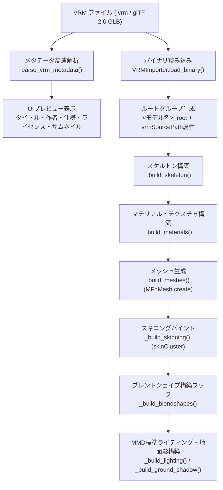

# VRM モデル (VRM 0.x / VRM 1.0) 解析・構築技術仕様書

> [!NOTE]
> 本詳細技術仕様書は、AI によって作成・整理されたドキュメントです。内容はソースコードおよび開発記録をもとに記述していますが、実際の動作と細部が異なる場合があります。

本ドキュメントは、「MMD Tools for Maya」の「その他モデルインポート（試験的機能・ベータ版）」における VRM 3D アバターモデル（glTF 2.0 GLB コンテナ形式: **VRM 0.x** および **VRM 1.0**）のバイナリ解析、メタデータ・サムネイル高速抽出、および Maya シーン構築（スケルトン・マテリアル・メッシュ・スキニング・ライティング・地面影）の技術仕様を定めたものです。

---

## 1. 全体アーキテクチャと処理フロー

VRM インポート機能は、UI 層（`ui_other_importer/`）と解析・シーン構築層（`other_converters/`）に明確に分離されており、外部ライブラリに依存せず Python 標準ライブラリ（`struct`, `json`, `os`, `math`）と Maya API 2.0（`maya.cmds`, `maya.api.OpenMaya`）のみで動作します。

### 関連モジュール一覧

| モジュール                              | 役割                                                                                                                                   |
| :-------------------------------------- | :------------------------------------------------------------------------------------------------------------------------------------- |
| `other_converters/vrm_importer.py`      | GLB バイナリ解析、VRM 0.x / 1.0 メタデータ抽出、Maya シーン構築エンジン (`VRMImporter`, `parse_vrm_metadata`, `import_vrm_model`)      |
| `other_converters/__init__.py`          | 外部モデルコンバーターパッケージのエクスポート定義                                                                                     |
| `ui_other_importer/importer_window.py`  | その他モデルインポーター独立ウィンドウ (`OtherModelImporterWindow`, `show_other_model_importer`)・ホットリロード管理                   |
| `ui_other_importer/tab_vrm_importer.py` | VRM 専用タブ UI (`TabVrmImporterWidget`, `VrmDropAreaLineEdit`)・ドラッグ＆ドロップ・メタデータ表示・インポート設定                    |
| `ui_other_importer/tab_cleanup.py`      | インポート済み VRM モデルおよび関連ノード（メッシュ・ボーン・マテリアル・テクスチャ・照明・地面影）の一括消去タブ (`TabCleanupWidget`) |
| `ui_other_importer/__init__.py`         | その他モデルインポーター UI パッケージのエクスポート定義                                                                               |

---

## 2. GLB バイナリフォーマット解析仕様 (`other_converters/vrm_importer.py`)

VRM ファイルは glTF 2.0 のバイナリコンテナ形式（GLB）を採用しています。`VRMImporter.load_binary()` は以下のバイナリ構造をリトルエンディアン（`<`）で解析します。

### 2-1. GLB ヘッダー・チャンク構造

1. **GLB ヘッダー（12バイト: `<4sII`）**
   - `magic`（4バイト）: `b"glTF"` を検証。不一致の場合は `ValueError` を送出。
   - `version`（uint32）: glTF バージョン（通常 `2`）。
   - `length`（uint32）: ファイル全体サイズ。
2. **チャンク 0: JSON チャンク（8バイトヘッダー + 本体）**
   - `chunk_length`（uint32）, `chunk_type`（uint32: `0x4E4F534A` = `"JSON"`）。
   - UTF-8（`errors="replace"`）でデコードし、`json.loads()` により `self.gltf` 辞書へ展開。
3. **チャンク 1: BIN チャンク（8バイトヘッダー + 本体）**
   - `chunk_length`（uint32）, `chunk_type`（uint32: `0x004E4942` = `"BIN\x00"`）。
   - 頂点・法線・UV・インデックス・埋め込み画像を含む生バイナリを `self.bin_buffer` へ格納。

### 2-2. アクセサ（Accessor）数値配列展開 (`get_accessor_data`)

glTF の `accessors[idx]` と参照先 `bufferViews[bv_idx]` を組み合わせ、バイナリバッファから任意の数値配列を展開します。

- **オフセット計算**: `byte_offset = bufferView.byteOffset + accessor.byteOffset`
- **ストライド解決**: `bufferView.byteStride` が指定されている場合はインターリーブ配列としてその間隔で走査し、未指定または 0 の場合は `num_components * element_size` を自動適用。
- **対応コンポーネント型 (`COMPONENT_STRUCT_FORMAT`)**:

| glTF `componentType` | 定数名                  | `struct` 書式 | バイト数 |
| :------------------- | :---------------------- | :------------ | :------- |
| `5120`               | `COMPONENT_TYPE_BYTE`   | `b` (int8)    | 1        |
| `5121`               | `COMPONENT_TYPE_UBYTE`  | `B` (uint8)   | 1        |
| `5122`               | `COMPONENT_TYPE_SHORT`  | `h` (int16)   | 2        |
| `5123`               | `COMPONENT_TYPE_USHORT` | `H` (uint16)  | 2        |
| `5125`               | `COMPONENT_TYPE_UINT`   | `I` (uint32)  | 4        |
| `5126`               | `COMPONENT_TYPE_FLOAT`  | `f` (float32) | 4        |

- **対応データ型 (`TYPE_NUM_COMPONENTS`)**: `SCALAR`(1), `VEC2`(2), `VEC3`(3), `VEC4`(4), `MAT4`(16)。`SCALAR` は単一値リスト、それ以外は要素リストの配列として返却します。

---

## 3. 高速メタデータ・サムネイル抽出仕様 (`parse_vrm_metadata`)

UI 上で VRM ファイルを選択またはドラッグ＆ドロップした瞬間に、巨大な BIN チャンク全体をメモリ展開せず高速にモデル情報をプレビュー表示するための軽量解析関数です。

### 3-1. VRM 0.x / VRM 1.0 の規格自動判別と差分吸収

`gltf["extensions"]` のキーを検査し、2つの規格を自動判別します。

| 項目                  | VRM 1.0 (`extensions.VRMC_vrm`)                          | VRM 0.x (`extensions.VRM`)                                                  |
| :-------------------- | :------------------------------------------------------- | :-------------------------------------------------------------------------- |
| **タイトル**          | `meta.name`                                              | `meta.title`                                                                |
| **作者**              | `meta.authors`（配列をカンマ連結）                       | `meta.author`                                                               |
| **バージョン / 許可** | `meta.avatarPermission`                                  | `meta.version`                                                              |
| **ライセンス**        | `meta.licenseUrl` / `meta.commercialUsage`               | `meta.licenseName` / `meta.commercialUsaOption` / `meta.otherPermissionUrl` |
| **サムネイル参照**    | `meta.thumbnailImage`（`images` 配列インデックス直指定） | `meta.texture` → `textures[idx].source` 経由で `images` インデックス解決    |
| **モーフ数集計**      | `len(expressions.preset) + len(expressions.custom)`      | `len(blendShapeMaster.blendShapeGroups)`                                    |

### 3-2. 部分シークによるサムネイル画像抽出

`images[thumb_image_idx].bufferView` からオフセット（`byteOffset`）とサイズ（`byteLength`）を取得し、BIN チャンク先頭位置（`12 + 8 + chunk0_length`）のヘッダー（`0x004E4942`）を確認した上で、`f.seek(bin_header_pos + 8 + b_offset)` によりサムネイル画像のバイト列のみをピンポイント読み込みします。`mimeType` から拡張子（`jpg` / `png`）を判定して返却します。

---

## 4. Maya シーン構築パイプライン (`VRMImporter.execute_import`)

### 4-1. 座標系・スケール変換オプション

| オプション名                                                                              | 既定値            | 内容                                                                      |
| :---------------------------------------------------------------------------------------- | :---------------- | :------------------------------------------------------------------------ |
| `scale`                                                                                   | `100.0`           | glTF 単位系（メートル）から Maya 標準単位系（センチメートル）への変換倍率 |
| `invert_z`                                                                                | `True`            | MMD ツール座標系（正面向き +Z）に統一するための Z 軸符号反転フラグ        |
| `material_type`                                                                           | `"mmdToonShader"` | シェーダー種別（`"mmdToonShader"`, `"standardSurface"`, `"lambert"`）     |
| `import_mesh` / `import_materials` / `import_bones` / `import_skinning` / `import_morphs` | すべて `True`     | 各構成要素の生成オン／オフ制御                                            |
| `create_lighting` / `create_ground_shadow`                                                | すべて `True`     | MMD 標準ライティングおよび地面影（シャドウキャッチャー）の自動構築        |

ルートノードは空のトランスフォームグループ `<ファイル名>_root` として生成され、元のファイルパスが文字列属性 `vrmSourcePath` に記録されます（クリーンアップタブでの自動検出キーとしても使用されます）。

### 4-2. スケルトン構築 (`_build_skeleton`)

親ノードのローカル回転累積によるジョイント歪みを防ぐため、事前に全ノードのワールド変換行列を算出してから Maya ジョイントを構築します。

- **ローカル 4×4 行列構築 (`_calc_local_matrix`)**: 各ノードの `translation`, `rotation`（クォータニオン XYZW）, `scale` から 4×4 変換行列を生成。
- **ワールド行列のメモ化再帰算出**: `parent_map` を辿り、`M_world(child) = M_world(parent) * M_local(child)` を全ノード分算出。
- **ワールド座標配置**: 算出された並進成分 `(m_w[3], m_w[7], m_w[11])` に `scale` と Z 軸反転（`invert_z=True` のとき `-m_w[11] * scale`）を適用し、`mc.joint(name=safe_name, position=[wx, wy, wz])` で階層順に生成（半径 `1.2`）。
- **メッシュ専用末端ノードの除外**: `mesh` を持ち子ノードを持たない末端ノードはボーン階層生成から除外。
- **Humanoid ボーン属性付与**: VRM 1.0（`VRMC_vrm.humanoid.humanBones`）または VRM 0.x（`VRM.humanoid.humanBones`）から解決した標準 Humanoid ボーン名を、各ジョイントのカスタム文字列属性 `humanoidBone` へ記録。

### 4-3. マテリアル・テクスチャ構築 (`_build_materials`)

1. **埋め込み画像の書き出し**:
   - `images` の各 `bufferView` から生バイト列を抽出し、VRM ファイルと同一ディレクトリ内の `<モデル名>_textures/tex_{img_idx}.png`（または `.jpg`）へ自動書き出し。
2. **シェーダー生成と多段フォールバック**:
   - `mmdToonShader` 指定時: `mmd_material` プラグインのロードを試行し、利用可能なら `mmdToonShader` を生成（`color`, `diffuseColor`, `ambientColor=(0,0,0)` 設定）。
   - 利用不可または `standardSurface` 指定時: `standardSurface`（`baseColor`, `specularRoughness=0.6`）を生成。
   - いずれも不可または `lambert` 指定時: Maya 標準 `lambert` へフォールバック。
3. **テクスチャおよび透過配線**:
   - `pbrMetallicRoughness.baseColorTexture` の画像を `file` + `place2dTexture` ノードで接続。
   - `alphaMode` が `"MASK"` または `"BLEND"` の透過マテリアル（瞳・眉・ハイライト・髪飾り等）では、目の周囲等の黒塗りを防ぐため以下を自動配線：
     - `standardSurface`: `file.outAlpha` → `opacityR / opacityG / opacityB`
     - `mmdToonShader` / `lambert`: `file.outTransparency` → `transparency`

### 4-4. ポリゴンメッシュ構築 (`_build_meshes`)

`nodes` から `mesh` を参照する各ノードと配下の `primitives` ごとに Maya ポリゴンメッシュを生成します。

- **頂点座標**: `POSITION` アクセサを展開し、`scale` と `invert_z` を適用して `om.MPointArray` を構築。
- **Z 軸反転時の面ワインディング順序スワップ**: `invert_z=True` の場合、右手／左手反転によるバックフェースカリング裏返りを防ぐため、各三角形の頂点インデックスを `(i0, i1, i2)` → `(i0, i2, i1)` へ入れ替え。
- **高速生成**: `om.MFnMesh().create(points, poly_counts, poly_connects)` によりポリゴンメッシュを一括生成し、`<mesh_name>_<prim_idx>` へリネームしてモデルルート配下へ配置。
- **法線適用**: `NORMAL` アクセサ（Z 反転時は `nz = -n[2]`）を `fn_mesh.setVertexNormals()` で適用。
- **UV 適用**: `TEXCOORD_0` アクセサに対し glTF（左上原点）→ Maya（左下原点）の V 座標変換（`1.0 - v`）を行い、`fn_mesh.setUVs()` / `assignUVs()` で割り当て。
- **マテリアル割当**: `prim.material` に対応するシェーディンググループ（SG）へ `mc.sets(..., forceElement=sg_node)` でアサイン。

### 4-5. スキニング構築 (`_build_skinning`)

各メッシュの所属ノードが参照する `skins[skin_idx].joints` から対応する Maya ジョイント群を抽出し、`mc.skinCluster(skin_joints, mesh_tr, toSelectedBones=True, maximumInfluences=4, normalizeWeights=1)` によりスキンクラスターを構築します。

### 4-6. ライティングおよび地面影構築 (`_build_lighting` / `_build_ground_shadow`)

- 既存の `maya_converters/pmxpaimaya.py` の `create_mmd_lighting(shadow_mode=1)` および `create_mmd_ground_shadow()` を優先呼び出しし、MMD モデルと統一された照明・地面影環境を構築。
- 呼び出し不可の場合は、平行光（`mmd_directional_light`, `rotate=(-54.74, 45.0, 0.0)`）＋環境光（`mmd_ambient_light`）および `useBackground` シェーダーによる地面影プレーン（`mmd_ground_shadow_plane`）を自前フォールバック生成します。

---

## 5. UI 連携およびクリーンアップ仕様 (`ui_other_importer/`)

- **独立ウィンドウ (`importer_window.py`)**:
  - `mmd_tools_for_maya_plugin.py` の MMD メニュー「その他モデルインポート (VRM等[試験的機能])...」から起動。
  - 多重起動防止、起動中スプラッシュダイアログ（`OtherModelImporterSplashDialog`）、および「UI再読込」ボタンによるホットリロード（`reload_importer_modules`）を搭載。
- **VRM タブ (`tab_vrm_importer.py`)**:
  - 左右スプリッター構成。左ペインで `.vrm` ドラッグ＆ドロップ入力とメタデータ・サムネイルプレビューを表示し、右ペインで各種生成オプション・マテリアル種別・スケール倍率・進行バー・ステータスログを提供。
- **一括消去タブ (`tab_cleanup.py`)**:
  - シーン内の `vrmSourcePath` 属性保持ノードおよび `*_root` グループを自動検出し、メッシュ・ボーン・スキンクラスター・関連マテリアル/SG・テクスチャ（`file` / `place2dTexture`）・未使用ノード・照明・地面影を選択式で一括削除。

---

## 6. ベータ版における現在の制約と今後の拡張予定

本機能は v1.0.6 時点で **試験的機能（ベータ版）** として提供されており、以下の項目は今後のアップデートでの拡張対象です。
ただし、必ずしもアップデートで追加されるとは限りません。

- **スキニングウェイト精密注入**: 現状は `mc.skinCluster` による標準バインド構成であり、`JOINTS_0` / `WEIGHTS_0` アクセサおよび `inverseBindMatrices` を用いた頂点単位ウェイト注入の高度化を予定。
- **表情ブレンドシェイプ展開 (`_build_blendshapes`)**: 現状は拡張用フック（プレースホルダー）として確保されており、`primitives[].targets` および VRM 0.x `blendShapeMaster` / VRM 1.0 `expressions` からの `blendShape` ターゲット自動生成を予定。
- **揺れもの物理 (SpringBone)**: VRM 0.x `secondaryAnimation` / VRM 1.0 `VRMC_springBone` の解析および Maya 物理連携の検討。
- **MToon 拡張パラメータ対応**: `VRM.materialProperties`（VRM 0.x）および `VRMC_materials_mtoon`（VRM 1.0）のシェードカラー・リムライト・アウトライン幅の自動マッピング拡張。
